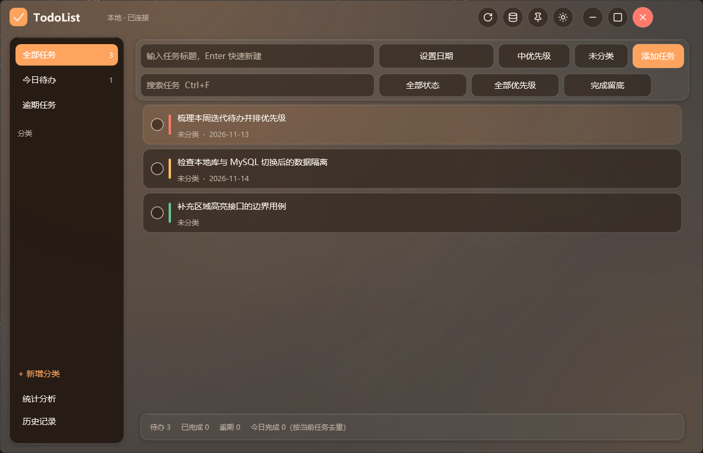
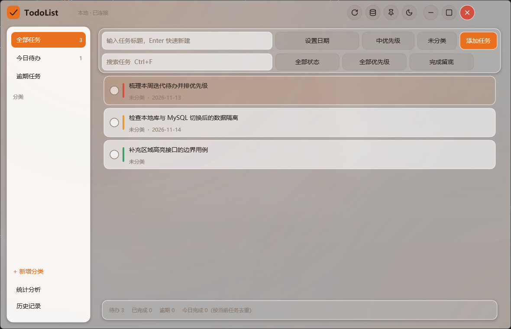
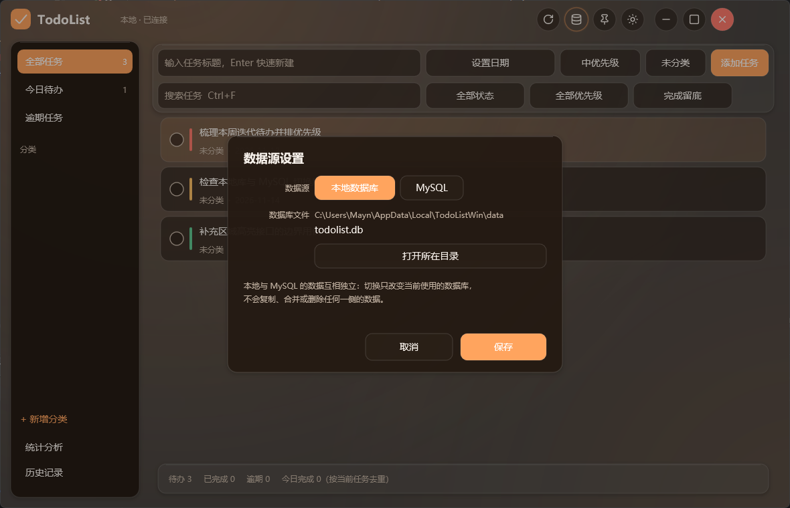

# TodoList for Windows

> 纯 C++20 + Win32 + Direct2D 1.1 全自绘的 Windows 桌面待办应用。无边框窗口、Acrylic 材质真透桌面、
> 橙白配色，本地 SQLite 与 MySQL 双数据源可在设置里热切换、无需重启。



## 特性

- **原生自绘界面**：不使用 Qt / MFC / wxWidgets，窗口与全部控件由 Direct2D 1.1 + DirectWrite 绘制，
  无任何系统默认控件外观；Per-Monitor V2 DPI 感知。
- **真实半透明**：`CreateSwapChainForComposition` + `DXGI_ALPHA_MODE_PREMULTIPLIED` +
  `WS_EX_NOREDIRECTIONBITMAP` + DWMWA Acrylic，窗口背景真的透出桌面，不是贴图模拟。
- **双数据源**：默认使用 `%LOCALAPPDATA%` 下的 SQLite 单文件库，开箱即用；也可在「数据库」设置里切到
  MySQL。切换在运行中完成，探测通过才提交，旧连接后台释放。
- **密码不落明文**：MySQL 密码经 Windows DPAPI（当前用户作用域）加密后存入
  `%LOCALAPPDATA%\TodoListWin\credentials\mysql.cred`，配置文件里没有密码行，界面也不会回填。
- **任务闭环**：回车新建、双击编辑、复选框完成/取消、悬停删除、拖拽排序、优先级、分类、截止日期
  （弹出式日历，不手输文本）。
- **系统视图与筛选**：全部任务 / 今日待办 / 逾期任务，配合关键词搜索、状态、优先级、完成留底策略。
- **历史与统计**：完成事件与任务状态在同一事务内写入历史；历史页按时段、分类、关键词过滤并支持恢复、
  永久删除；统计页为自绘环形完成率、分类柱状图与近 7 天趋势。
- **桌面集成**：拖拽移动、边缘缩放、置顶、最小化到托盘、亮/暗主题跟随系统。

| 浅色 | 数据源设置 |
| --- | --- |
|  |  |

## 下载即用

仓库内 `dist/win64/` 提供已构建好的 Release 版本，解压后直接双击 `todolist4win_mysql.exe` 即可，
无需安装、无需 MySQL——首次启动会自动落到本地 SQLite 库。

```
dist/win64/
  todolist4win_mysql.exe
  libcrypto-1_1-x64.dll
  libssl-1_1-x64.dll
  msvcp140.dll  msvcp140_atomic_wait.dll  vcruntime140.dll  vcruntime140_1.dll
  README.md              # 免安装版的运行说明
```

## 从源码构建

### 依赖

| 依赖 | 说明 |
| --- | --- |
| Windows 10 1903+ / Windows 11，x64 | 仅支持 x64，工程不含 Win32 配置 |
| Visual Studio 2022 或更高 | 需勾选「使用 C++ 的桌面开发」工作负载；工具集自动探测 v145 → v143 → v142 |
| Windows 10 SDK | `Directory.Build.props` 固定 `WindowsTargetPlatformVersion=10.0` |
| MySQL Connector/C++ 8.0 x64 | **仅**编译 MySQL 数据源时需要。安装到默认位置，或设置环境变量 `MYSQLCONNECTOR_ROOT` 指向解压目录 |

MySQL 依赖的路径集中在 `build/MySqlDependencies.props`，只改这一处即可适配别的安装位置。

### 命令

```bat
build.bat test           :: 编译并运行单元测试
build.bat app            :: 编译应用（Debug）
build.bat app Release    :: 编译应用（Release，可分发版本）
build.bat start Release  :: 运行已构建的 Release 版本
build.bat clean          :: 清理 bin\ 与 obj\
```

产物位于 `bin\<Configuration>\todolist4win_mysql.exe`。

也可以直接用 Visual Studio 打开 `todolist4win_mysql.sln`（仅 `Debug|x64` 与 `Release|x64`）。

## 数据存放与安全

传统桌面软件的布局：配置随用户漫游，数据与凭据留在本机。

| 内容 | 路径 |
| --- | --- |
| 配置 | `%APPDATA%\TodoListWin\config.ini`（UTF-16LE，含 BOM） |
| 本地数据库 | `%LOCALAPPDATA%\TodoListWin\data\todolist.db` |
| MySQL 凭据 | `%LOCALAPPDATA%\TodoListWin\credentials\mysql.cred`（DPAPI 加密） |
| 日志 | `%LOCALAPPDATA%\TodoListWin\Logs\todolist.log` |

> **关于默认连接参数**：程序内置了一组本地开发用的占位默认值（`localhost:3306/root/123456`），
> 用来让本地开发环境开箱可用，它**不是**任何真实环境的凭据。请在自己的机器上通过「数据库」设置改成
> 实际账号，密码会加密保存。

## 目录结构

```
src/
  domain/      领域模型与业务规则（不依赖 Windows / Direct2D / SQL）
  core/        服务层，只依赖仓储接口
  data/        仓储实现：MySQL 与 SQLite，SQL 只出现在这一层
  ui/          自绘控件、窗口、渲染与主题
  app/         装配、控制器、后台 worker 与完成队列
  config/      配置读写、路径解析、DPAPI 凭据保管
build/         第三方依赖路径的集中配置
docs/          需求、架构、数据源设计、文本溢出审计
tests/         领域规则、仓储契约、事务、凭据、切换状态机测试
third_party/   SQLite 3.45.3 amalgamation
dist/          预构建的 Windows x64 可运行版本
```

## 测试

```bat
build.bat test
```

测试工程不连接数据库：仓储契约通过 `IUnitOfWorkFactory` 抽象在 SQLite 上执行，MySQL 侧的集成测试需要
显式编译开关与一个专用于测试的库名（见 `tests/MySqlIntegrationTests.cpp` 的门控）。

## 快捷键

| 快捷键 | 作用 |
| --- | --- |
| `Ctrl+N` | 聚焦新建任务输入框 |
| `Ctrl+F` | 聚焦搜索框 |
| `Ctrl+T` | 切换窗口置顶 |
| `Ctrl+H` | 打开历史页 |
| `Esc` | 关闭弹层 / 取消编辑 |
| `↑` `↓` | 在任务列表中切换选中项 |

## 已知限制

- 仅 Windows x64；不含 Win32/x86 配置。
- 界面仅中文。
- 本地库与 MySQL 库互相独立，切换数据源只改「当前使用哪一侧」，**不做数据迁移或合并**。
- 尚不支持导入/导出与快捷键自定义（规划中）。
- 多显示器热插拔、远程桌面会话切换下的 DPI 边界场景未做穷举验证。
- 超长文本（分类名超过约 9 个汉字、标题超过约 6～8 个汉字）在列表与筛选条上会被横向截断；
  单行输入框没有水平滚动，插入符会移出可视区。已梳理全部调用点，见
  [docs/TEXT-OVERFLOW-AUDIT.md](docs/TEXT-OVERFLOW-AUDIT.md)。

## 第三方组件

见 [THIRD-PARTY-NOTICES.md](THIRD-PARTY-NOTICES.md)。其中 MySQL Connector/C++ 为 GPLv2 + FOSS
Exception，本项目以 MIT 许可发布并据此使用。

## 许可证

[MIT](LICENSE)
