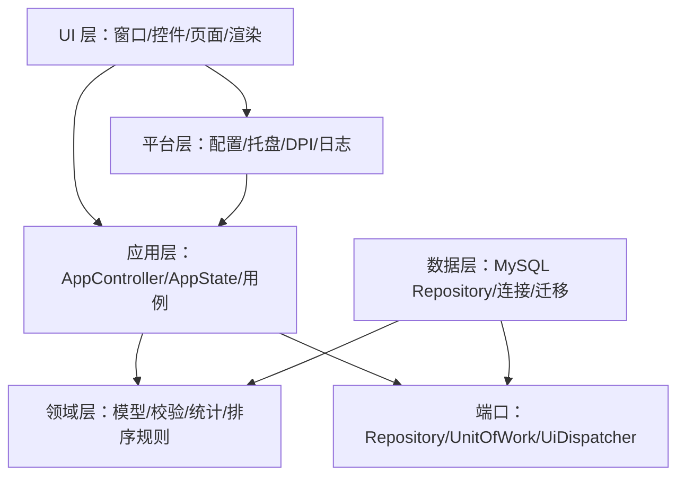
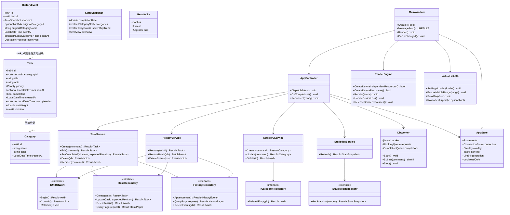
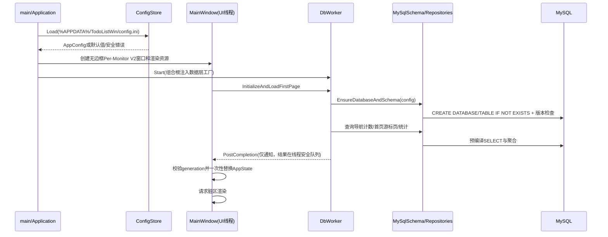
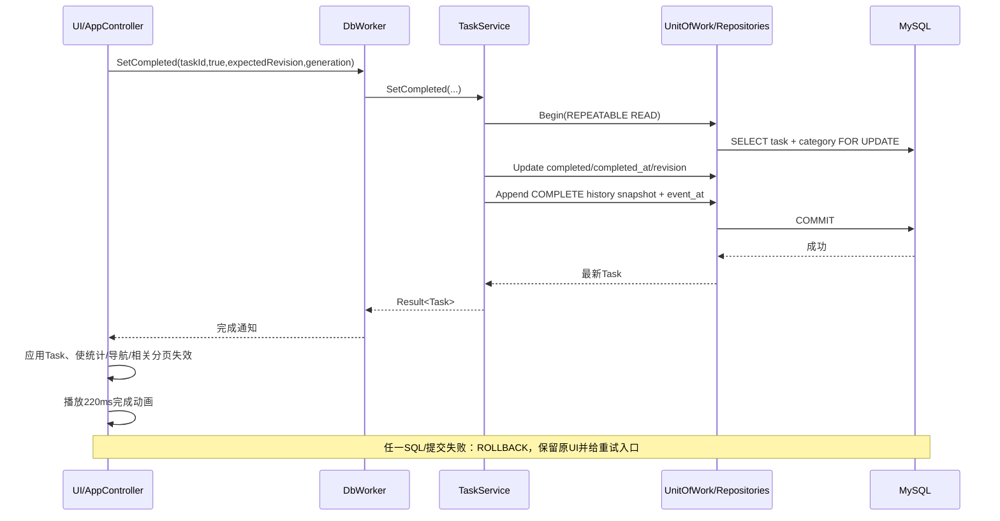
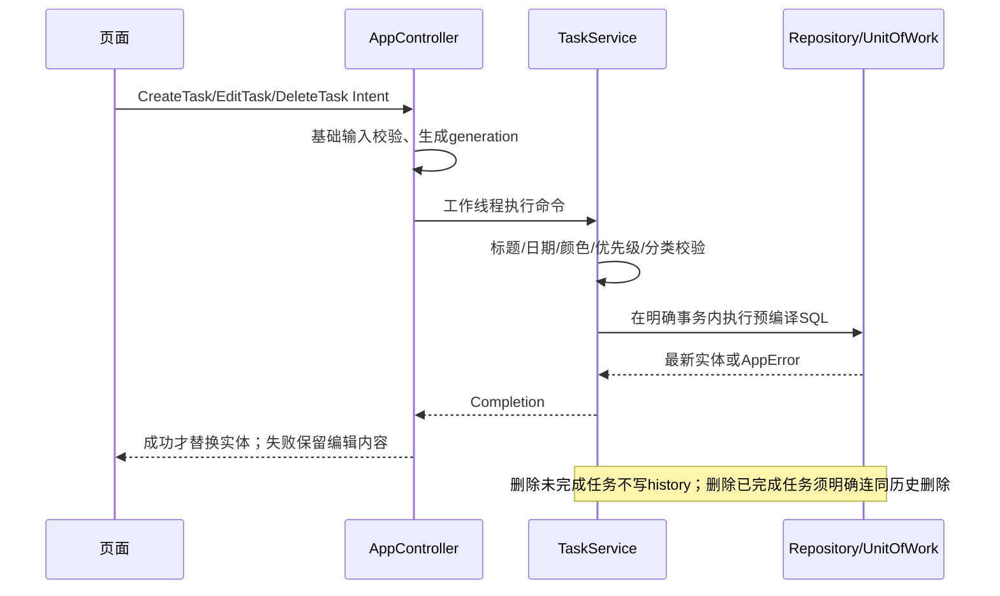
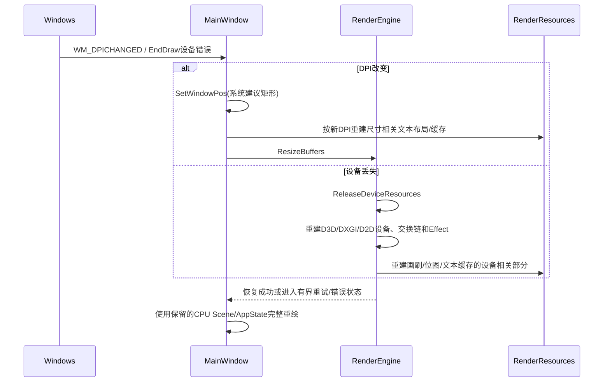
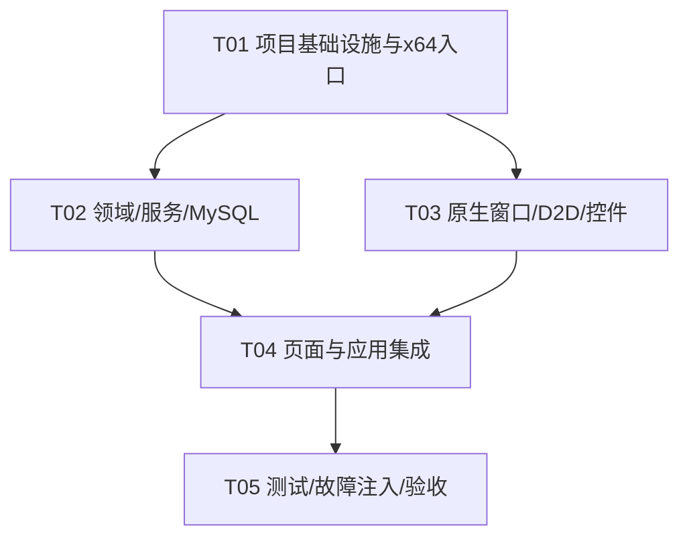

# TodoList for Windows 系统架构与任务分解

> 项目：`todolist4win_mysql`  
> 目标系统：Windows 10 1903+ / Windows 11  
> **交付架构：仅 Win64 / x64。Visual Studio 2022 仅提供 `Debug|x64` 与 `Release|x64`，不提供 Win32/x86 配置；所有导入库、静态库和 DLL 必须为 64 位。**  
> 本文中的“纯 Win32 API”是 Microsoft 原生 Windows API 的技术名称，不表示 32 位程序。  
> 输入：`docs/PRD.md` 及主理人给出的 7 项产品默认约定。  
> 文档性质：架构与实施计划，不包含实现代码，也不声称视觉、性能或外部依赖已实测。

---

## Part A：系统设计

## 1. 实现方案与框架选型

### 1.1 核心技术难点

1. 在无 Qt/MFC/wxWidgets 的前提下，实现无边框窗口、自绘控件、中文输入法、拖拽、滚动、弹层、托盘与多 DPI。
2. Direct2D 1.1 透明交换链、玻璃背景、文本与图表绘制，以及设备丢失后的完整资源重建。
3. MySQL 写入、历史事件、恢复、删除和统计必须采用统一且可验证的一致性语义，不能在数据库失败时“乐观假成功”。
4. 数据库 I/O 不得阻塞 UI；同时必须防止后台结果在窗口销毁、页面切换或查询变更后错误覆盖新状态。
5. 1 万 task、10 万 history 下需要服务端筛选/聚合、游标分页和列表虚拟化，不能一次性把所有记录加载到内存。
6. 外部 MySQL Connector/C++ 8.0 静态链接及其传递依赖因发行包而异，必须集中配置，不能假设某台机器已经安装或验证。

### 1.2 技术选型

| 领域 | 选型 | 理由与边界 |
| --- | --- | --- |
| 语言/编译 | C++20，MSVC，VS2022，x64 | 满足硬约束；启用 `/W4 /permissive- /EHsc`，禁用 x86 平台。 |
| 原生窗口 | Win32 API（Win64/x64 程序） | 直接控制消息循环、无边框命中测试、DPI、IME、托盘，不引入 UI 框架。 |
| 渲染 | Direct2D 1.1 + DirectWrite；D3D11/DXGI/DirectComposition 作为承载 | Direct2D 1.1 的 `ID2D1DeviceContext` 配合透明交换链，支持 Effect、设备重建和自绘图表。 |
| 玻璃背景 | 文档化 DWM API + Direct2D Effect | Win10 使用 `DwmEnableBlurBehindWindow` 可用路径；Win11 可按 SDK/系统版本启用系统 Backdrop。不支持时退化为半透明渐变与阴影，明确标注降级。 |
| 数据库 | MySQL Connector/C++ 8.0 Legacy JDBC API，静态库 | `sql::mysql::MySQL_Driver`、预编译语句和事务接口适合关系模型；不引入 ORM。 |
| 数据访问 | Repository + Unit of Work | UI 不出现 SQL；跨表操作在应用服务中定义事务边界。 |
| 并发 | UI 线程 + 单一数据库工作线程 + 队列 | Connector 连接对象只在工作线程使用；通过 UI 通知队列回到主线程，避免跨线程 COM/D2D 对象。 |
| 状态管理 | UI 线程单一 `AppState` + 请求 generation | 页面、筛选、连接状态和加载数据有唯一所有者；过期异步结果直接丢弃。 |
| 配置 | Win32 INI 读写 + 原子替换 | 不引入 JSON/注册表框架；路径集中于 `%APPDATA%/TodoListWin/config.ini`。 |
| 测试 | 轻量原生测试入口 + MySQL 集成测试 | 避免为测试再引入大型框架；集成测试使用独立数据库，禁止清空业务库。 |

### 1.3 分层架构



依赖规则：

- `domain` 不依赖 Win32、Direct2D、MySQL 或页面。
- `core` 只依赖领域模型和抽象接口，不包含 SQL、HWND 或 D2D 类型。
- `data` 实现接口，独占 SQL、Connector 类型与异常翻译。
- `ui` 通过 `AppController` 发命令、读取 `AppState`；不得直接调用 Repository。
- `Application` 是唯一组合根，负责创建、连接和销毁各层对象。
- 所有写操作先提交数据库，成功后返回最新实体/统计版本，再更新 UI；不维护“待保存成功”的假状态。

---

## 2. 完整文件列表

以下路径均相对仓库根目录。工程只需用 VS2022 打开 `todolist4win_mysql.sln`，平台仅 x64。

```text
todolist4win_mysql.sln
todolist4win_mysql.vcxproj
todolist4win_mysql.vcxproj.filters
Directory.Build.props
build/
  MySqlDependencies.props
app.manifest
resources/
  app.ico
  resource.h
  resources.rc
src/
  main.cpp
  app/
    Application.h
    Application.cpp
    AppController.h
    AppController.cpp
    AppState.h
    UiDispatcher.h
    Win32UiDispatcher.h
    Win32UiDispatcher.cpp
    TrayService.h
    TrayService.cpp
    Logger.h
    Logger.cpp
  common/
    Result.h
    Error.h
    Clock.h
    Clock.cpp
    Guid.h
    Guid.cpp
  domain/
    Models.h
    TaskRules.h
    TaskRules.cpp
    SortWeight.h
    SortWeight.cpp
    Statistics.h
    Statistics.cpp
    TimeRanges.h
    TimeRanges.cpp
  core/
    RepositoryInterfaces.h
    TaskService.h
    TaskService.cpp
    CategoryService.h
    CategoryService.cpp
    HistoryService.h
    HistoryService.cpp
    StatisticsService.h
    StatisticsService.cpp
    DbWorker.h
    DbWorker.cpp
  data/
    MySqlConnection.h
    MySqlConnection.cpp
    MySqlSchema.h
    MySqlSchema.cpp
    MySqlUnitOfWork.h
    MySqlUnitOfWork.cpp
    MySqlTaskRepository.h
    MySqlTaskRepository.cpp
    MySqlCategoryRepository.h
    MySqlCategoryRepository.cpp
    MySqlHistoryRepository.h
    MySqlHistoryRepository.cpp
    MySqlStatisticsRepository.h
    MySqlStatisticsRepository.cpp
    MySqlErrors.h
    MySqlErrors.cpp
  config/
    AppConfig.h
    AppConfig.cpp
    ConfigStore.h
    ConfigStore.cpp
  ui/
    MainWindow.h
    MainWindow.cpp
    Dpi.h
    Dpi.cpp
    Theme.h
    Theme.cpp
    RenderEngine.h
    RenderEngine.cpp
    RenderResources.h
    RenderResources.cpp
    Backdrop.h
    Backdrop.cpp
    RenderScheduler.h
    RenderScheduler.cpp
    AnimationClock.h
    AnimationClock.cpp
    NavigationView.h
    NavigationView.cpp
    TaskPage.h
    TaskPage.cpp
    HistoryPage.h
    HistoryPage.cpp
    StatisticsPage.h
    StatisticsPage.cpp
    SettingsDialog.h
    SettingsDialog.cpp
    ToastView.h
    ToastView.cpp
    controls/
      Control.h
      Control.cpp
      Button.h
      Button.cpp
      TextBox.h
      TextBox.cpp
      CheckBox.h
      CheckBox.cpp
      ScrollBar.h
      ScrollBar.cpp
      PopupMenu.h
      PopupMenu.cpp
      ModalDialog.h
      ModalDialog.cpp
      VirtualList.h
      VirtualList.cpp
      TaskListControl.h
      TaskListControl.cpp
      HistoryListControl.h
      HistoryListControl.cpp
      ChartsControl.h
      ChartsControl.cpp
tests/
  todolist4win_mysql_tests.vcxproj
  TestMain.cpp
  TaskRulesTests.cpp
  SortWeightTests.cpp
  StatisticsTests.cpp
  TimeRangesTests.cpp
  ConfigStoreTests.cpp
  MySqlIntegrationTests.cpp
  UiStateTests.cpp
docs/
  PRD.md
  ARCHITECTURE.md
  class-diagram.mermaid
  sequence-diagram.mermaid
```

`resources/app.ico` 是需要真实制作的二进制资源；不得以空文件或伪造图标代替。若某阶段未制作完成，应显示构建资源缺失，而不是声称视觉验收完成。

---

## 3. 核心数据结构、类与接口

### 3.1 领域模型和语义

| 模型 | 关键字段 | 约定 |
| --- | --- | --- |
| `Category` | `id, name, color, createdAt` | 系统视图不进入此表；`id` 是关联依据。 |
| `Task` | `id, categoryId?, title, note, priority, dueAt?, completed, createdAt, completedAt?, sortWeight, revision` | 完成任务仍保留 task 行；`revision` 用于过期写入冲突检测。 |
| `HistoryEvent` | `id, taskId, snapshot..., originalCategory..., eventAt, completedAt?, operationType` | `COMPLETE` 与 `UNCOMPLETE` 均为追加事件；快照不随分类改名改变。 |
| `TaskFilter` | `keyword, priority?, completion, dueRange?` | 与页面路由组合；关键词长度受限并转义 LIKE 通配符。 |
| `HistoryFilter` | `keyword, categoryId?, timeRange?` | 时间按 `event_at` 过滤，使用半开区间。 |
| `PageRequest<TCursor>` | `pageSize, cursor?` | 默认每页 200；游标必须带排序及筛选签名。 |
| `StatsSnapshot` | `completionRate, categoryCounts, sevenDayTrend, overview` | 全部由数据库聚合，不从分页缓存推算全局结果。 |
| `AppConfig` | 数据库、窗口、置顶、主题和完成展示策略 | 密码只用于连接和掩码输入，不进入日志/普通状态展示。 |

枚举：

- `Priority { High, Medium, Low }`，分别映射 `#FF3B30/#FF9500/#34C759`。
- `Route { AllTasks, Today, Overdue, Category, History, Statistics }`。
- `CompletionDisplay { KeepVisible, Archive }`；归档只是主待办列表过滤完成项，不删除数据。
- `OperationType { Complete, Uncomplete }`。
- `ConnectionState { Initializing, Online, Degraded, Reconnecting, Error }`。
- `Overlay { None, TaskEditor, CategoryEditor, ConnectionSettings, Confirm }`。

主要接口（签名表达契约，不是实现代码）：

- `ITaskRepository`：`Create`、`Update`、`DeleteTask`、`GetByIdForUpdate`、`QueryPage`、`Reorder`。
- `ICategoryRepository`：`Create`、`Update`、`DeleteIfEmpty`、`ListWithCounts`。
- `IHistoryRepository`：`Append`、`QueryPage`、`DeleteEvents`、`GetLatestForTask`。
- `IStatisticsRepository`：`GetSnapshot(rangeToday, rangeSevenDays)`。
- `IUnitOfWork`：`Begin`、`Commit`、`Rollback`，可在同一事务中访问所需 Repository。
- `IUnitOfWorkFactory`：在工作线程创建事务上下文，不跨线程共享连接。
- `IUiDispatcher`：`PostCompletion()`，只通知 UI 排空线程安全结果队列，不投递需手动释放的裸指针。
- `IClock`：生产环境取系统时间，测试可替换；应用服务统一生成业务时间和本地日期边界。

### 3.2 类图

独立可渲染版本见 `docs/class-diagram.mermaid`。



---

## 4. 数据库 DDL、索引与事务边界

### 4.1 初始化与版本策略

1. 首次连接不指定数据库，使用配置中的账号连接服务器；执行 `CREATE DATABASE IF NOT EXISTS todolist_db ...`，再以 `todolist_db` 建立业务连接。
2. 默认账号若缺少建库权限，应返回“权限不足”并打开配置入口，不能改用其他数据库伪装成功。
3. DDL 在 MySQL 中会隐式提交，因此初始化采用**幂等 DDL + 最后记录 schema 版本**，不宣称建库建表处于单事务。
4. 已存在更高或不兼容版本时停止写入并提示；自动迁移禁止 `DROP`、清空或重写用户数据。
5. 字符集统一 `utf8mb4`，表引擎 InnoDB；生产库只使用预编译语句。

### 4.2 Version 1 DDL

```sql
CREATE DATABASE IF NOT EXISTS todolist_db
  CHARACTER SET utf8mb4 COLLATE utf8mb4_0900_ai_ci;

CREATE TABLE IF NOT EXISTS schema_migration (
  version       INT NOT NULL PRIMARY KEY,
  applied_at    DATETIME(6) NOT NULL
) ENGINE=InnoDB;

CREATE TABLE IF NOT EXISTS category (
  id            BIGINT UNSIGNED NOT NULL AUTO_INCREMENT PRIMARY KEY,
  name          VARCHAR(80) NOT NULL,
  color         CHAR(7) NOT NULL,
  created_at    DATETIME(6) NOT NULL,
  CONSTRAINT uq_category_name UNIQUE (name)
) ENGINE=InnoDB;

CREATE TABLE IF NOT EXISTS task (
  id            BIGINT UNSIGNED NOT NULL AUTO_INCREMENT PRIMARY KEY,
  category_id   BIGINT UNSIGNED NULL,
  title         VARCHAR(500) NOT NULL,
  note          TEXT NOT NULL,
  priority      VARCHAR(8) NOT NULL,
  due_time      DATETIME(6) NULL,
  completed     TINYINT(1) NOT NULL DEFAULT 0,
  created_at    DATETIME(6) NOT NULL,
  completed_at  DATETIME(6) NULL,
  sort_weight   DOUBLE NOT NULL,
  revision      BIGINT UNSIGNED NOT NULL DEFAULT 1,
  CONSTRAINT fk_task_category FOREIGN KEY (category_id)
    REFERENCES category(id) ON DELETE RESTRICT ON UPDATE RESTRICT,
  CONSTRAINT ck_task_priority CHECK (priority IN ('HIGH','MEDIUM','LOW')),
  CONSTRAINT ck_task_completed CHECK (completed IN (0,1)),
  CONSTRAINT ck_task_completion_time CHECK (
    (completed = 0 AND completed_at IS NULL) OR
    (completed = 1 AND completed_at IS NOT NULL)
  ),
  INDEX ix_task_manual (sort_weight, id),
  INDEX ix_task_category_manual (category_id, sort_weight, id),
  INDEX ix_task_due (completed, due_time, sort_weight, id),
  INDEX ix_task_completed_at (completed, completed_at),
  INDEX ix_task_category_stats (category_id, completed)
) ENGINE=InnoDB;

CREATE TABLE IF NOT EXISTS history (
  id                      BIGINT UNSIGNED NOT NULL AUTO_INCREMENT PRIMARY KEY,
  task_id                 BIGINT UNSIGNED NOT NULL,
  title                   VARCHAR(500) NOT NULL,
  note                    TEXT NOT NULL,
  priority                VARCHAR(8) NOT NULL,
  due_time                DATETIME(6) NULL,
  original_category_id    BIGINT UNSIGNED NULL,
  original_category_name  VARCHAR(80) NULL,
  original_category_color CHAR(7) NULL,
  task_created_at         DATETIME(6) NOT NULL,
  completed_at            DATETIME(6) NULL,
  event_at                DATETIME(6) NOT NULL,
  operation_type          VARCHAR(16) NOT NULL,
  CONSTRAINT fk_history_task FOREIGN KEY (task_id)
    REFERENCES task(id) ON DELETE CASCADE ON UPDATE RESTRICT,
  CONSTRAINT ck_history_priority CHECK (priority IN ('HIGH','MEDIUM','LOW')),
  CONSTRAINT ck_history_operation CHECK (operation_type IN ('COMPLETE','UNCOMPLETE')),
  INDEX ix_history_event (event_at, id),
  INDEX ix_history_task (task_id, id),
  INDEX ix_history_category_event (original_category_id, event_at, id),
  INDEX ix_history_trend (operation_type, event_at)
) ENGINE=InnoDB;
```

说明：

- `category_id = NULL` 表示“未分类”，不是可被删除的系统分类。
- `history.original_category_id` 故意不设外键；名称和颜色快照保留删除分类前的原貌。
- `fk_history_task ON DELETE CASCADE` 只用于“明确删除已完成 task 及其历史”或普通 task 删除；永久删除历史时只执行 `DELETE FROM history ...`，不会删除 task。
- 使用 MySQL 8.0.16+ 以获得强制 CHECK 约束；旧版本必须在启动检查中提示不支持，不能假设约束有效。
- 分类名在当前大小写不敏感 collation 下唯一，避免界面出现无法区分的重复名称。

### 4.3 时间与排序统一语义

- 本期明确采用**本地墙上时间**：所有 `DATETIME(6)` 均由应用转换为本机本地时间后写入，MySQL 不做时区转换，也不依赖数据库 `NOW()`。
- 截止日期是用户所选本地日期的 `23:59:59.000000`；清空截止日期写 `NULL`。
- “今日”为本地 `[今天 00:00, 明天 00:00)`；“近 7 天”为 `[今天-6 天 00:00, 明天 00:00)`，含今天。
- 逾期：`completed = 0 AND due_time IS NOT NULL AND due_time < 当前本地时间`。
- 跨时区同步和 DST 重名时间不是本期能力；若系统时区改变，历史墙上时间不会自动换算，作为已知限制记录。
- 全部任务/用户分类：`ORDER BY sort_weight, id`；今日/逾期：`ORDER BY due_time, sort_weight, id`，只读不可拖拽。
- 每项任务只有一个全局 `sort_weight`。分类内拖拽只改变被拖任务相对可见邻居的权重；其他分类任务在“全部任务”中的位置可随之变化。
- 新任务取当前全局最大权重 + 1024。插入优先取邻居中点；当权重非有限值或间隙小于 `1e-9` 时，在单事务内按当前全局顺序以 1024 间隔重编号。每次更新仍按 `id` 保证确定性。

### 4.4 事务边界

| 操作 | 事务内容 | 失败/冲突行为 |
| --- | --- | --- |
| 新建 | 校验分类；插入 task | 失败不插入、不更新 UI；无 history。 |
| 编辑 | 按 `id + expectedRevision` 更新 task | 0 行表示不存在或版本冲突，重新加载并提示。 |
| 完成 | `SELECT ... FOR UPDATE`；更新 completed/completed_at/revision；追加 `COMPLETE` 快照 | 任一步失败整体回滚；不在内存提前打勾。 |
| 取消完成 | 锁原 task；原位设未完成、清 completed_at；追加 `UNCOMPLETE` 快照 | 不新建 task，不删除旧 history。 |
| 历史恢复 | 按 task_id 锁已完成 task；执行同一“取消完成”事务 | 不复制任务；过期快照只提供入口，实际状态以锁定行校验。 |
| 删除未完成待办 | 删除 task；通常无历史 | 不写 history；UI 先确认。 |
| 删除已完成任务 | 明确选择“任务及其历史”；删除 task，FK 级联 history | 单事务；不能只删列表项留下孤儿语义。 |
| 永久删除历史 | 仅按 history id 批量删除事件 | 不修改 task；二次确认；趋势随事件删除而减少。 |
| 分类改名/颜色 | 更新 category | 不回写历史快照。 |
| 删除分类 | 锁分类并确认无 task 引用，再删除 | 非空返回 `CategoryNotEmpty`，提示先迁移；空分类可删。 |
| 拖拽/重编号 | 锁相关行，更新权重及 revision；必要时全量重编号 | 失败回滚并恢复原列表。 |
| 批量恢复 | **每个 task 独立子事务**，汇总逐项结果 | 成功项更新，失败项保留并标明原因；不得静默丢失或伪报全成功。 |

事务隔离默认 `REPEATABLE READ`。所有跨表写入必须在同一个连接/事务中，禁止 Repository 内部擅自提交外层事务。

### 4.5 统计口径

- 完成率：当前 `task` 按 task id 去重，`completed = 1` 数 / 当前 task 总数；分母为 0 时显示 0%，不除零。
- 分类柱状图：当前 task 按 category 分组统计总量和完成量；未分类单列。
- 近 7 天趋势：按 `history.operation_type = 'COMPLETE'` 的 `event_at` 计数；每次完成是一条事件，取消完成不回删；永久删除事件会改变趋势。
- 底部“今日完成”：当前已完成且 `completed_at` 落在今日的 task 去重数量，因此与“历史事件中的今日完成次数”可能不同，UI 用提示说明口径。
- 待办、已完成、逾期均基于当前 task；统计必须重新查询数据库，不基于当前分页样本外推。

---

## 5. 程序调用流程

主时序图独立文件见 `docs/sequence-diagram.mermaid`。

### 5.1 启动、初始化与首屏



数据库初始化异步进行，窗口可以先展示“正在连接”。首次连接失败时没有离线缓存；连接曾经成功后断库，保留当前已加载页面，只读并标明“可能不是最新数据”。

### 5.2 完成任务（关键一致性链路）



### 5.3 新建、编辑与删除



### 5.4 DPI 与设备丢失



---

## 6. UI 状态、页面路由与交互

### 6.1 路由

| Route | 主内容 | 排序/写入 | 加载方式 |
| --- | --- | --- | --- |
| `AllTasks` | 当前任务列表，按完成展示策略过滤 | 可拖拽；按全局权重 | 关键词/优先级/完成筛选 + 游标分页 |
| `Today` | 未完成且截止日期为今天的任务 | 只读；due_time、权重 | 游标分页 |
| `Overdue` | 未完成且已逾期任务 | 只读；due_time、权重 | 游标分页 |
| `Category(id)` | 指定分类任务 | 可拖拽；同一全局权重过滤视图 | 游标分页 |
| `History` | 完成/取消完成事件快照 | 恢复、永久删除；无排序拖拽 | 默认 `event_at DESC,id DESC`，游标分页 |
| `Statistics` | 环图、分类柱图、7 日折线 | 无任务写入 | 独立聚合查询 |

路由切换不销毁数据库连接。切换时递增查询 generation、取消尚未开始的旧查询并保留各自最近一页缓存；缓存必须显示连接状态，不能冒充实时结果。

### 6.2 `AppState` 分区

- `navigation`：当前 route、分类列表与计数。
- `taskQuery`：关键词、优先级、完成筛选、游标和页映射。
- `historyQuery`：时间范围、分类、关键词、选择集和游标。
- `editor`：任务/分类编辑草稿；数据库失败时草稿不丢失。
- `connection`：状态、可展示错误摘要、重试次数；不保存可复制密码。
- `preferences`：置顶、关闭到托盘、完成展示策略、主题。
- `stats`：最近一次成功统计及其数据版本。
- `interaction`：焦点控件、键盘选中项、拖拽、模态层和动画状态。

### 6.3 输入与快捷键

- Ctrl+N：恢复主窗口，切到全部任务，聚焦新建标题。
- Ctrl+F：聚焦当前任务/历史搜索框；统计页可切回任务搜索。
- Ctrl+T：切换置顶，系统调用成功后持久化。
- Ctrl+H：打开历史页。
- Esc：优先关闭最上层确认/菜单，再取消编辑。
- 上/下：仅在列表拥有焦点时移动选中；文本框编辑时不抢占 IME/光标行为。
- 自绘 `TextBox` 必须处理 `WM_CHAR`、选择、剪贴板、撤销边界及 `WM_IME_STARTCOMPOSITION/WM_IME_COMPOSITION/WM_IME_ENDCOMPOSITION`，并把候选窗定位到插入符附近；否则中文输入验收不通过。
- 所有核心操作都有可见按钮入口；右键菜单只是快捷方式。

### 6.4 列表虚拟化

- `VirtualList` 只实例化可视区及上下各 5 行绘制/命中缓存；行高由 DIP 与内容布局计算。
- 数据按 200 条游标页加载；页缓存采用有界 LRU（建议最多 20 页，实测后调整）。
- 游标包含排序键和 id，以及路由/筛选签名；签名不一致不得续页。
- 插入、完成、删除、恢复、分类变化后，使受影响页和统计失效，从第一页或稳定游标重新加载；不得直接插入到错误的过滤页。
- 拖拽期间固定数据快照和命中行，显示半透明占位；数据库提交成功后才更新权威顺序，失败则回位。
- 历史 10 万行使用 keyset，禁止深 `OFFSET`；搜索 `%keyword%` 在 10 万规模下须实测，不能承诺索引加速。

---

## 7. Direct2D 资源、DPI、玻璃与设备丢失

### 7.1 资源所有权

设备无关资源：

- `ID2D1Factory1`、`IDWriteFactory`、WIC factory。
- 字体族/字号规格、CPU 场景树、颜色主题、路径几何和图标描述。

设备相关资源：

- D3D11 device/context、DXGI swap chain、DirectComposition device/target/visual。
- `ID2D1Device`、`ID2D1DeviceContext`、target bitmap。
- D2D brush、bitmap、effect graph、text layout 的 DPI/尺寸相关缓存。

`RenderEngine` 独占设备相关资源；页面不得把画刷或设备上下文长期存入模型。DirectWrite factory 可复用，但文字布局在 DPI、宽度、字体或文本变化时重建。

### 7.2 Per-Monitor V2

- manifest 声明 `PerMonitorV2`；运行时使用 `SetProcessDpiAwarenessContext(DPI_AWARENESS_CONTEXT_PER_MONITOR_AWARE_V2)` 作为兼容初始化路径，失败要记录。
- 所有布局、圆角、字体和命中区域用 DIP；只有窗口矩形、鼠标物理消息和 surface 尺寸转为像素。
- `WM_DPICHANGED` 使用建议矩形，更新 scale、交换链和文本缓存；不得把旧位图拉伸冒充 DPI 适配。
- `WM_GETMINMAXINFO` 按当前 monitor 工作区限制最大化；`WM_NCHITTEST` 提供标题拖动和边缘缩放；最大化时禁用边缘缩放。
- 100% DPI 基线：窗口圆角 14、标题 18px 半粗、正文 14px、辅助 12px；高 DPI 等比换算为 DIP/像素。

### 7.3 玻璃策略

1. 透明 swap chain 使用预乘 Alpha，避免黑边。
2. 背景采样优先使用当前系统支持的文档化 DWM Backdrop；Win10 1903 走 `DwmEnableBlurBehindWindow` 可用路径。
3. Direct2D 多层 Gaussian Blur、半透明填充、高光和柔和阴影用于面板/内部材质层；系统 Backdrop 不可读取时不伪称对其进行了像素级采样。
4. API 不可用或设备能力不足时，明确降级为半透明渐变材质；不使用未公开 Accent API 作为必要依赖。
5. 窗口移动、主题切换、最大化和 DPI 变化后使背景/阴影缓存失效，避免采样撕裂和残影。
6. 无额外视觉稿，仅按 PRD 文字参数建立基线，不能声称与 iOS 26 “1:1 已验证”。

### 7.4 设备丢失

- `Present/EndDraw` 检查 `D2D1ERR_RECREATE_TARGET`、`DXGI_ERROR_DEVICE_REMOVED`、`DXGI_ERROR_DEVICE_RESET`。
- 先释放全部设备相关资源，再按错误等级重建交换链或 D3D/D2D 设备；CPU `AppState` 和编辑草稿保持不变。
- 重建采用有界退避，不能每帧忙循环；连续失败显示可重试错误层。
- `WM_DISPLAYCHANGE`、锁屏恢复、远程桌面和显卡重置均走同一失效/重建路径。

---

## 8. 动画计时与渲染策略

- `AnimationClock` 使用 `QueryPerformanceCounter`，所有插值依据绝对开始时间和 elapsed time，不按帧数推进。
- `RenderScheduler` 仅在有动画、拖拽、输入或脏区时安排帧；空闲时停止计时器和 Present。
- 使用短周期 `WM_TIMER` 触发合并后的重绘，`Present(1)` 与刷新同步；60fps 是目标，不承诺计时器单独保证 60fps。
- 单帧 `dt` 最大钳制 50ms，避免断点/挂起后动画跳跃；所有动画最终状态由数据状态决定，而非动画回调决定保存。
- 复选框：220ms 填充、对勾和 1.05 弹性缩放；按钮点击 0.95；主题 300ms；图表仅值变化时插值。
- 新纪录/删除动画在数据库成功结果返回后播放。快速连续操作以 request id + revision 防旧结果覆盖。
- 拖拽期间复用命中快照、限制 Effect 重建并只重绘脏区；动画中不得改变实际数据顺序直到提交成功。
- 尊重系统“关闭不必要动画”设置，可降级为立即最终状态。
- 性能测试记录帧时间分布、P95/P99 和持续掉帧，不只报告平均 fps。

---

## 9. MySQL 连接、后台线程与 UI 同步

### 9.1 连接生命周期

- `MySqlConnection` 是工作线程专属 RAII 对象，连接、statement、result set 不得交给 UI 线程。
- 启动、配置修改、手动重试和自动重连均在工作线程执行；设置 connect/read/write timeout，避免无限等待。
- 每次命令前检查连接有效性；只有确认连接失效才重建，事务中出错先 rollback。
- 自动重连采用 1/2/5/10/30 秒上限的指数退避，应用隐藏或退出时停止；不无限弹窗。
- 数据库进入 Degraded/Error 后所有写入口禁用，保留已加载数据只读；绝不把写请求排队后显示“已保存”。

### 9.2 请求/结果协议

每个请求包含：`requestId`、`generation`、`command`、`submittedAt`。每个结果包含：原 id/generation、`OperationResult<T>`、完成时间和安全诊断码。

- `DbWorker` 单线程顺序执行，保证同一用户的完成/取消/拖拽不会乱序。
- 页面切换可取消未开始的读请求；正在执行的 SQL 不假装已取消，结果返回后按 generation 丢弃。
- 写请求不能因路由切换被悄悄丢弃；退出时禁止新写，停止未开始请求，等待当前调用在既定 timeout 内结束后再销毁连接。
- `Win32UiDispatcher` 只 `PostMessage(WM_APP_DB_COMPLETION)`；真实结果存于有锁队列。窗口销毁时清空队列，避免裸指针消息泄漏。
- UI 每次消息批量排空 completion，先检查窗口代次和 generation，再更新 `AppState`；D2D 只在 UI 线程调用。

### 9.3 静态链接约束

`build/MySqlDependencies.props` 集中定义：

- `MySqlConnectorRoot`：用户可修改的 64 位 Connector/C++ 8.0 安装目录。
- 头文件目录、库目录、`MySqlCppConnStaticLib`（默认候选 `mysqlcppconn-static.lib`，以实际包为准）。
- 额外 64 位传递库及目录：可能包括 MySQL client、OpenSSL、zlib、Protobuf 等，**不得凭名称猜测已满足**。
- 所需预处理器宏和 VC Runtime 设置；应用与 Connector 的 CRT、`_ITERATOR_DEBUG_LEVEL`、 calling convention 必须匹配。

建议 Release 使用与官方包匹配的 `/MD`。Debug 也必须显式配置成可链接的 x64 组合；若实际包不兼容 Debug CRT，则使用匹配的 Release CRT/库做 Debug 编译，而不是混用 `/MDd`。构建前由 MSBuild 检查目录和库是否存在并给出明确错误。仓库不伪造库、不提交本机绝对路径，也不宣称静态链接已在本机验证。

---

## 10. 配置、托盘与置顶持久化

### 10.1 配置文件

路径：`%APPDATA%/TodoListWin/config.ini`；日志：`%LOCALAPPDATA%/TodoListWin/Logs/todolist.log`。

配置分区：

| 分区 | 键 | 默认/规则 |
| --- | --- | --- |
| `database` | `host, port, username, password, database, connect_timeout_seconds` | `localhost, 3306, root, 123456, todolist_db, 5`；用户修改并测试成功后覆盖。 |
| `window` | `topmost, close_to_tray, bounds_dip, last_dpi, maximized` | 默认非置顶、关闭到托盘；恢复时钳制到可见工作区。 |
| `appearance` | `theme_mode, completion_display` | 默认跟随系统；完成项默认留底。 |

- 保存采用同目录临时文件 + flush + `MoveFileEx` 原子替换，避免中断损坏配置。
- 非法端口、空主机、未知枚举回退到安全默认并记录非敏感错误；不能用坏配置覆盖最后可用配置。
- 连接设置对话框密码掩码显示，日志仅记录 host/port/user（必要时 user 也可脱敏），绝不记录 password、连接串或含参数的 SQL。
- 本期凭据静态保护不是承诺项，配置文件仅依赖用户目录 ACL；DPAPI/多配置档案属于后续增强，不能声称已加密。

### 10.2 托盘与窗口

- 稳定托盘 GUID + `Shell_NotifyIcon`，回调使用 `WM_APP_TRAY`；菜单含新建任务、打开主窗口、退出。
- 关闭按钮默认隐藏到托盘，不退出数据库 worker；“退出”才执行有序关闭。
- 托盘“新建任务”恢复窗口、应用原置顶状态、切到新建并聚焦。
- Ctrl+T/标题栏按钮调用 `SetWindowPos(HWND_TOPMOST/HWND_NOTOPMOST)`，成功后保存配置。
- 最小化、最大化、托盘恢复都走统一 `RestoreWindow`；恢复后重新检查 monitor、DPI 和 backdrop。
- 亮/暗主题默认跟随系统，通过 `WM_SETTINGCHANGE` 和系统应用主题设置刷新；不依赖只支持 Win11 的 API。

---

## 11. 错误处理与日志

| 错误码 | UI 行为 |
| --- | --- |
| `InvalidInput` | 字段旁显示具体原因，保留草稿，不发 SQL。 |
| `NotFound` / `Conflict` | 提示记录已变化，刷新相关行；不覆盖新数据。 |
| `CategoryNotEmpty` | 提示先迁移任务，分类保持不动。 |
| `ConnectionFailed` / `Timeout` | 进入只读/错误态，提供“重试”和“连接设置”。 |
| `AuthenticationFailed` / `PermissionDenied` | 打开配置并给出安全摘要，不显示密码或堆栈。 |
| `QueryFailed` / `SchemaUnsupported` | 禁止可能损坏数据的写入，保留现场，记录诊断码。 |
| `Cancelled` | 静默丢弃过期读结果；写操作不以取消伪报成功。 |
| `Internal` | 友好错误层和日志定位信息，消息边界捕获异常，防止进程崩溃。 |

- `data` 在边界捕获 `sql::SQLException`，转换为 `AppError`，保存 MySQL error code/sqlState（可脱敏）到日志；不得把异常抛入 Win32 消息过程。
- 日志采用大小上限和滚动（建议 1MB × 3），记录请求 id、操作、耗时、错误码，不记录标题/备注全文、密码或完整查询参数。
- 单条损坏记录应隔离并提示该行不可显示；不能因为一行时间/优先级非法而清空整页。schema 严格校验与应用防御性解析同时存在。
- 数据库写失败时保留原行和编辑草稿；用户主动重试才重新提交，避免自动重复写导致重复历史。

---

## Part B：任务分解

## 12. 依赖包与外部组件

```text
- Visual Studio 2022 (MSVC v143, C++20): Win64/x64 编译与工程系统
- Windows SDK 10.0.19041.0 或更新兼容版本: Win32 API/Direct2D 1.1/DirectWrite/D3D11/DXGI/DirectComposition/DWM
- MySQL Connector/C++ 8.0.x (x64, Legacy JDBC static library): 数据库连接、预编译语句和事务
- Connector 实际发行包要求的 x64 传递库: 由 MySqlDependencies.props 显式配置，可能含 client/OpenSSL/zlib/Protobuf
- Windows 系统库: d2d1, dwrite, d3d11, dxgi, dcomp, dwmapi, windowscodecs, shlwapi, shell32, user32, gdi32, imm32, ole32
```

无 Qt、MFC、wxWidgets、ORM、Boost、React 或额外运行时框架。Connector 的版本、静态库名和传递依赖必须以实际 x64 包为准，未安装时工程应明确报错。

## 13. 有序任务列表（最多 5 项）

| Task ID | Task Name | Source Files（均来自第 2 节） | Dependencies | Priority |
| --- | --- | --- | --- | --- |
| **T01** | **项目基础设施与 x64 原生入口** | `todolist4win_mysql.sln`、两个主工程 `.vcxproj/.filters`、`Directory.Build.props`、`build/MySqlDependencies.props`、`app.manifest`、`resources/*`、`src/main.cpp`、`src/app/Application.h/.cpp`、`src/common/Result.h`、`src/common/Error.h` | 无 | P0 |
| **T02** | **领域规则、配置、应用服务与 MySQL 持久化** | `src/common/Clock.*, Guid.*`、`src/domain/*`、`src/core/*`、`src/data/*`、`src/config/*`、`src/app/UiDispatcher.h` | T01 | P0 |
| **T03** | **Win64 原生窗口、D2D 渲染与全自绘控件** | `src/ui/MainWindow.*`、`Dpi.*`、`Theme.*`、`RenderEngine.*`、`RenderResources.*`、`Backdrop.*`、`RenderScheduler.*`、`AnimationClock.*`、`src/ui/controls/*` | T01 | P0/P1 |
| **T04** | **页面、托盘与应用集成闭环** | `src/app/AppController.*`、`AppState.h`、`Win32UiDispatcher.*`、`TrayService.*`、`Logger.*`、`src/ui/NavigationView.*`、`TaskPage.*`、`HistoryPage.*`、`StatisticsPage.*`、`SettingsDialog.*`、`ToastView.*`，并按需集成 `Application/MainWindow` | T02、T03 | P0/P1 |
| **T05** | **自动化测试、故障注入与最终验收打磨** | `tests/todolist4win_mysql_tests.vcxproj`、`tests/TestMain.cpp`、`tests/TaskRulesTests.cpp`、`SortWeightTests.cpp`、`StatisticsTests.cpp`、`TimeRangesTests.cpp`、`ConfigStoreTests.cpp`、`MySqlIntegrationTests.cpp`、`UiStateTests.cpp`，以及针对缺陷修改对应模块 | T04 | P0/P1 |

实施说明：

- T01 只建 `Debug|x64` 和 `Release|x64`，删除/不生成任何 Win32 配置；外部依赖路径必须可修改。
- T02 与 T03 在 T01 后可并行；T04 负责组合根接线，不把业务逻辑塞入页面。
- T05 不是“性能已达成”任务，而是测量和修复任务；报告必须列硬件、MySQL 版本、数据集和测量口径。

## 14. 跨文件共享约定

```text
- 仅交付 Win64/x64；纯 Win32 API 指原生 Windows API，不是 x86。
- 所有异步结果使用 OperationResult<T>/AppError；UI 不捕获 Connector 异常、不拼 SQL。
- 所有时间使用应用生成的本地 DATETIME(6) 语义；日期范围为 [start,end)，近7天含今天。
- 完成保留task并同事务追加COMPLETE；取消/恢复原位更新task并追加UNCOMPLETE。
- 永久删除history不删task；删除已完成task必须明确连同history删除；未完成删除不写history。
- 当前task完成率按task去重；7日趋势按COMPLETE事件计数，取消不回删。
- sort_weight全局唯一语义；全部/分类可拖拽，今日/逾期只读。
- UI坐标和字体使用DIP；渲染资源和数据库连接均不得跨线程使用。
- 写操作提交成功后才更新权威AppState；断库只读，不做离线假成功。
- 所有列表查询有页大小上限，历史使用keyset；统计使用数据库聚合。
- 密码、连接串、SQL参数、标题/备注正文不得写日志；设置界面密码掩码。
- 公共ID使用有符号int64承载MySQL UNSIGNED值并校验上限；禁止把0当有效ID。
- 资源字符串、颜色和快捷键统一从Theme/资源定义获取，不在页面散落魔法值。
```

## 15. 任务依赖图



## 16. 测试与性能验收设计

- 单元：空标题/非法日期/颜色/优先级、当天结束、今日与近 7 天边界、完成率除零、统计去重、权重中点与重编号、配置损坏恢复。
- 数据集成：独立测试库中验证幂等建表、事务回滚、完成/取消历史、历史恢复不复制、两种永久删除语义、非空分类阻止删除、revision 冲突。
- UI 状态：过期 generation 不覆盖新查询、断库后写禁用、已加载页只读、批量恢复部分成功可见、托盘退出时结果队列安全清理。
- 手工矩阵：x64 Windows 10 1903+/11；100%/125%/150%/200%；多显示器移动；亮暗切换；最大化/还原；中文 IME；停库/恢复；D2D 设备重建。
- 性能数据集：1 万 task、10 万 history，分类和完成事件分布需记录。冷启动分数据库可用/不可用，查询报告 P95/P99，内存说明指标和稳定 60 秒口径。
- 所有性能数值在实测前均标记“目标/未测”；不得写成已经满足 `<800ms / 60fps / <35MB / P95<100ms`。

## 17. 待明确事项、默认假设与风险

### 17.1 已采用、不再等待确认的默认项

1. 无额外视觉稿，以 PRD 文字参数为基线，不声称 1:1。
2. 完成、取消、恢复、删除和统计采用第 4 节语义。
3. 全局 sort_weight；今日/逾期只读。
4. 截止日为本地 23:59:59，DATETIME 统一本地墙上时间，近 7 天含今天。
5. 默认连接可被持久化配置覆盖；断库只读已加载数据且不伪报保存。
6. 1 万/10 万仅为后续验收参考，需要分页和虚拟化，性能不预声明。

### 17.2 剩余风险与假设

| 项 | 假设/风险 | 处理 |
| --- | --- | --- |
| Win10 玻璃 | 文档化 DWM 能力不等于 Win11 最新材质，无法承诺任意桌面背景下与参考一致 | 先实现可用 Backdrop + 降级材质；P1 验收记录系统版本和差异，不引入私有 API 冒险。 |
| Connector 静态链接 | 不同 8.0 包的库名、CRT、OpenSSL/Protobuf 传递依赖不同 | `.props` 集中配置，MSBuild 预检；实际安装后做一次 x64 链接验证，未做前标风险。 |
| 自绘文本/IME | 中文候选窗、选择、剪贴板和焦点工作量大 | 将 TextBox 作为 T03 必验控件，不能以自绘静态文本冒充输入框。 |
| 本地时间 | 修改系统时区/DST 不会重解释历史 DATETIME | 本期明确不支持跨时区；若未来支持需迁移为 UTC instant。 |
| 多进程 | 产品为单用户桌面应用，未承诺多实例同步 | revision 与行锁防过期写；不承诺跨实例实时推送。 |
| 关键词搜索 | `%中文关键词%` 无法利用普通前缀索引 | 先限长、分页并实测；不在本期贸然引入 ngram/fulltext 新语义。 |
| 全局权重重编号 | 极端频繁拖拽会触发全表重编号 | 阈值检测、单事务执行并记录耗时；后续可改十进制/分段策略。 |
| 内存目标 | DirectComposition、D2D 和 Connector 静态库可能使 <35MB 难以达到 | 使用真实 x64 构建测量后再优化，不能通过隐藏/排除进程内存伪报。 |
| 历史批量恢复 | 网络故障可能出现部分成功 | 每项独立事务并展示逐项结果；UI 不清空失败选择。 |
| 默认 root 凭据 | 仅适合本机开发，root 权限和明文配置存在安全风险 | 作为 PRD 默认，不用于生产宣称；界面提示可修改，凭据加密留待后续。 |

除上述明确限制外，没有需要阻塞 Engineer 开工的问题。T01 可先建立 x64 工程；外部 Connector 未安装时能够阅读/编译不依赖 Connector 的模块，但完整链接必须明确报告缺少依赖，不能跳过。
