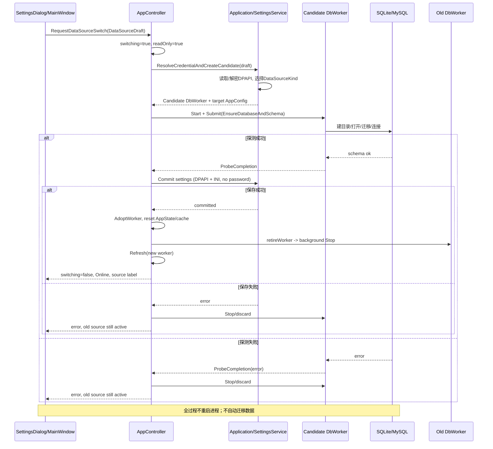
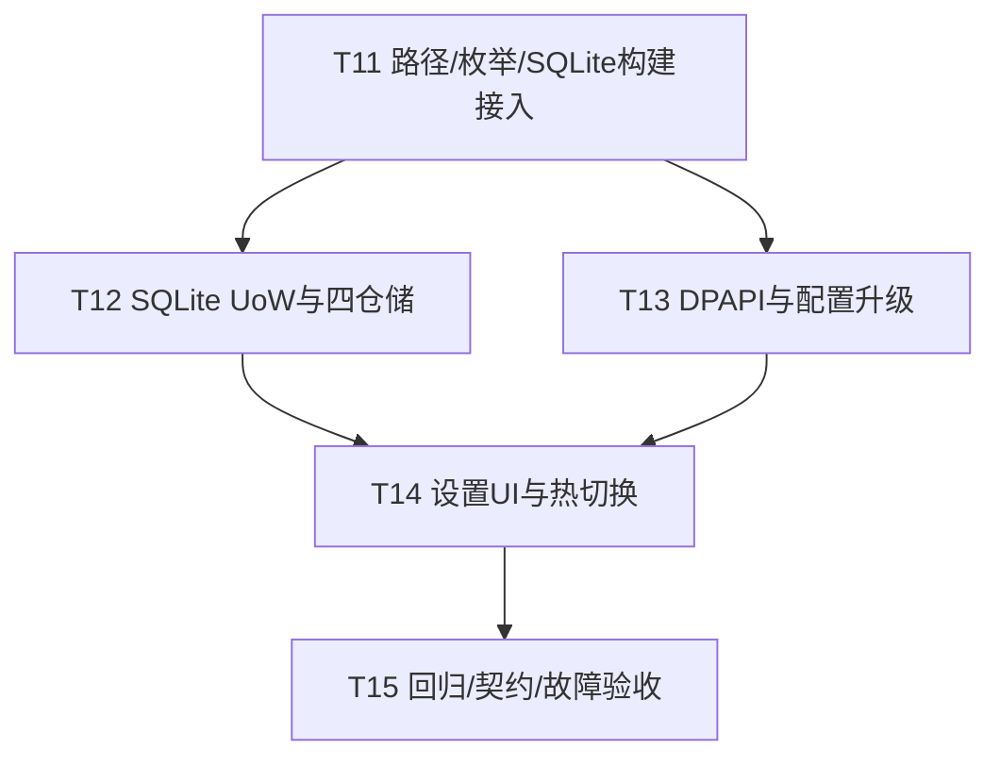

# 本地 SQLite 数据源与加密凭据增量设计

> 项目：`todolist4win_mysql`  
> 文档性质：增量架构与实施计划；**不包含实现代码**，不声称任何性能、兼容性或加密能力已实测。  
> 输入：主理人核实的现有代码事实、用户已拍板事项、`docs/ARCHITECTURE.md`。  
> 目标：默认使用本地 SQLite 单文件库；MySQL 退为设置中可配置的数据源；MySQL 密码使用 Windows DPAPI 加密保存；数据源热切换，不重启应用；本次不做 MySQL → 本地的数据迁移。

---

## 0. 结论摘要

1. **默认数据源改为 SQLite 本地库**，文件为 `%LOCALAPPDATA%\TodoListWin\data\todolist.db`。
2. **配置仍放 `%APPDATA%\TodoListWin\config.ini`**；数据、WAL/SHM、DPAPI 凭据放 `%LOCALAPPDATA%\TodoListWin\`，避免漫游冲突和 DPAPI 跨机失效。
3. SQLite 使用 **WAL + `synchronous=NORMAL` + `foreign_keys=ON` + `busy_timeout=5000ms`**；DB Worker 单线程，所有写事务使用 `BEGIN IMMEDIATE`。
4. 新增 `SqliteUnitOfWorkFactory` 和四个 SQLite 仓储，复用现有 `IUnitOfWorkFactory`/`IUnitOfWork` 接口；`domain`/`core` 不增加任何 Win32、SQLite、DPAPI 依赖。
5. MySQL 密码只以 **DPAPI 用户作用域密文**保存在 `%LOCALAPPDATA%\TodoListWin\credentials\mysql.cred`；`config.ini` 永远不写 `password=`。
6. 旧配置升级检测：没有 `[data] source` 但 `[database]` 有旧 MySQL 键时保持 **MySQL** 生效；全新安装默认 **local**。旧明文密码在首次成功迁移到 DPAPI 后，通过整份 INI 原子重写删除。
7. 数据源切换采用 **先探测、后切换**：先在候选 `DbWorker` 上完成 `EnsureDatabaseAndSchema` 探测，成功后才提交配置/凭据并 Adoption；失败不破坏旧数据源和旧 UI。
8. 本次不做数据迁移。切换只改变当前数据源视图，两份数据各自保留；不会复制、合并或删除另一份数据。
9. 默认本地模式下不需要 MySQL **服务**；完整应用仍保留 MySQL Connector 编译/运行依赖（见风险 15.1），这不等同于需要已启动 MySQL。
10. 所有现有 336 项离线测试必须保持通过；测试工程继续不链接 MySQL Connector，新增 SQLite/DPAPI 测试也不访问网络。

---

## 1. 目录布局与持久化边界

### 1.1 最终路径

| 内容 | 最终路径 | 原因 |
| --- | --- | --- |
| 普通配置 | `%APPDATA%\TodoListWin\config.ini` | 窗口、主题、数据源选择等可漫游；不包含秘密。 |
| SQLite 数据库 | `%LOCALAPPDATA%\TodoListWin\data\todolist.db` | 本地数据，不应漫游；SQLite 锁文件/WAL 也不适合漫游。 |
| SQLite WAL/SHM | `%LOCALAPPDATA%\TodoListWin\data\todolist.db-wal`、`todolist.db-shm` | SQLite 运行时副文件，和主库同一目录。 |
| MySQL 凭据 | `%LOCALAPPDATA%\TodoListWin\credentials\mysql.cred` | DPAPI 用户作用域密文；换机器/换用户不可解密，不能漫游。 |
| 日志 | `%LOCALAPPDATA%\TodoListWin\Logs\todolist.log` | 维持现有日志位置；不写密码、连接串或 SQL 参数。 |

### 1.2 路径实现约定

- 新增 `AppPaths`，使用 `SHGetKnownFolderPath(FOLDERID_RoamingAppData/FOLDERID_LocalAppData)`；失败时回退 `%APPDATA%`/`%LOCALAPPDATA%`。
- 仍失败时返回可展示错误，**不得**把 SQLite 文件或凭据静默写到当前工作目录/Program Files。
- 所有目录/文件名集中常量，禁止在 UI、Repository、ConfigStore 各自拼路径。
- `ConfigStore::DefaultPath()` 改为调用 `AppPaths`；测试继续允许显式注入临时路径。

### 1.3 不做数据迁移的含义

- 从 MySQL 切到本地：本地只有已有 SQLite 数据；若首次使用则自动建空库，不导入 MySQL 记录。
- 从本地切到 MySQL：显示 MySQL 中的数据；不导入、不覆盖本地库。
- 两套数据的 `task.id`/`history.id` 是各自命名空间，不做交叉引用；切换后分页游标、缓存、当前分类必须重置。
- UI 在数据源设置中显示“两套数据独立，不自动迁移”。切换不能删除另一侧数据。

---

## 2. 配置模型与兼容升级

### 2.1 `AppConfig` 变更

在 `src/config/AppConfig.h` 增加：

```cpp
enum class DataSourceKind { Local, MySql };

struct AppConfig {
    DataSourceKind dataSource{DataSourceKind::Local};
    DatabaseConfig database;   // MySQL 字段继续保留，password 仅运行时
    WindowConfig window;
    AppearanceConfig appearance;
    void Sanitize() noexcept;
};
```

`DatabaseConfig` 字段保持现有兼容：`host`、`port`、`username`、`password`、`database`、`connectTimeoutSeconds`。

- `host/port/username/database/timeout` 继续按 PRD 默认值生成 MySQL 表单。
- `password` 是**运行时字段**，不是持久化字段；`ConfigStore::Save` 永不输出它。
- 首次本地安装不会因 MySQL 未配置而报错；MySQL 只有在用户选择并保存时才需要凭据。
- 为保持与既有 PRD 默认值兼容，`DatabaseConfig.password` 可保留当前出厂默认值作为内存默认；它只在 MySQL 被选中并完成保存/切换时进入 DPAPI，不进入 INI。若产品后续要求“首次 MySQL 必须显式输入密码”，只需在设置 UI 层取消该默认值，不影响数据层。

`Sanitize()`：

- 继续清理 `host`、`port`、`username`、`database`、`connect_timeout_seconds` 和窗口几何。
- 不因 `dataSource == Local` 删除 MySQL 配置/凭据，用户可能稍后切回 MySQL。
- `password` 不做日志输出、不做隐式 trim；空字符串是有效运行时值，但“空输入 = 沿用已保存密码”的语义由设置层解析，不能由 `Sanitize` 猜测。

### 2.2 INI 格式

最终格式：

```ini
[data]
source=local

[database]
host=localhost
port=3306
username=root
database=todolist_db
connect_timeout_seconds=5

[window]
...
[appearance]
...
```

- `[data] source` 只允许 `local|mysql`。
- `[database]` 继续保留 MySQL 的 host/port/username/database/timeout，**没有 `password` 行**。
- `ConfigStore::Save` 仍用 UTF-16LE、临时文件 + `MoveFileExW(MOVEFILE_REPLACE_EXISTING|MOVEFILE_WRITE_THROUGH)` 整份重写，并调用现有 `WritePrivateProfileStringW(nullptr,nullptr,nullptr,path)` 清缓存。
- `Save` 不调用 `WritePrivateProfileStringW(section,key,nullptr,...)` 删除密码，因为：
  1. 该 API 是就地修改，不是原子替换；
  2. 可能留下旧文件编码/缓存状态；
  3. 整份 INI 重写已经能删除历史 `password=`，且与现有原子保存策略一致。
- 因此“首次保存时删除明文密码”由 `ConfigStore::Save` 的完整重写保证；迁移流程必须先完成 DPAPI 保存，再调用这个 Save。

### 2.3 旧配置升级判定（必须精确）

`ConfigStore::Load()` 的顺序：

1. 尝试读取 `[data] source`。
2. 若存在且为 `local` 或 `mysql`（大小写不敏感，去除首尾空白），直接采用。
3. 否则检查 `[database]` 段的“旧配置键”：`host`、`port`、`username`、`password`、`database`、`connect_timeout_seconds` 任意一个存在，即判定为旧版 MySQL 配置，`dataSource = MySql`。
4. 若 `[database]` 无上述键（或 section 不存在），`dataSource = Local`。
5. 若 `[data] source` 存在但值非法：按第 3 步判定；这样可以修复损坏的新字段，同时不丢失老用户的 MySQL 配置语义。

行为要求：

- 全新安装没有 config 文件 → `Local`。
- 现有用户有当前版本生成的 `[database]` → 升级后仍以 MySQL 启动，不能默认显示空本地库让用户误以为数据丢失。
- 用户显式保存 `source=local` 后，即使 `[database]` 仍有历史字段，后续也必须以 local 启动。
- `ConfigStore::Save` 写 `[data]` 段；旧配置在第一次成功保存后从“隐式 MySQL”变为显式 `source=mysql`。

### 2.4 明文密码迁移与清理

旧版本 `[database] password=...` 的处理流程：

1. `ConfigStore::Load` 读出旧密码到内存 `DatabaseConfig.password`，同时记录 `legacyPlaintextPresent_ = true`；该值不写入日志。
2. 若 DPAPI 凭据文件不存在，`SettingsService` 将旧密码交给 `DpapiCredentialVault::Save`。
3. DPAPI 保存成功后：
   - 标记 `legacyPlaintextPresent_ = false`；
   - 调用 `ConfigStore::Save` 整份重写 INI，不输出 password；
   - 第 3 步失败时保留旧 INI 和明文密码，不能制造“已加密”的假象；记录可展示错误并允许下一次重试。
4. DPAPI 保存失败时：
   - 不覆盖旧明文，不把空密码当有效密码；
   - 若当前数据源是 MySQL，继续使用内存中旧密码只能作为“迁移尚未完成”的临时状态，UI 必须明确警告；
   - 任何 config 保存前都检查 `legacyPlaintextPresent_`，为 true 时 `ConfigStore::Save` 返回 `Conflict`（“凭据尚未完成安全迁移，配置未改写”），避免后续保存把旧密码删掉却未成功加密。
5. 迁移成功后再次启动只从 DPAPI 加载；INI 中不存在 password。

`ConfigStore` 公开只读状态 `HasLegacyPlaintextPassword()`，仅供 `SettingsService`/Application 迁移编排；不暴露密码内容给 UI/日志。

---

## 3. 凭据保险箱（DPAPI）

### 3.1 分层与接口

**接口归属**：`src/config/CredentialVault.h`，纯 C++ 接口，只依赖 `Result` 和 `std::string`/`std::optional`，不依赖 Win32。

```cpp
class ICredentialVault {
public:
    virtual ~ICredentialVault() = default;
    // 成功返回密码；成功但没有文件返回 nullopt。
    virtual Result<std::optional<std::string>> Load() = 0;
    virtual Result<void> Save(const std::string& password) = 0;
    virtual Result<void> Remove() = 0;
    virtual Result<bool> Exists() const = 0; // 或由 SettingsService 通过 Load 处理
};
```

- `DpapiCredentialVault`：`src/config/DpapiCredentialVault.h/.cpp`，包含 `windows.h`/`wincrypt.h`，实现 DPAPI；**不进入 domain/core**。
- `SettingsService`/`Application` 负责调用保险箱；`AppController` 和 `main` 不知道 DPAPI 细节。
- UI 只得到 `hasSavedCredential` 布尔值和状态文案，不显示已解密密码。
- 测试可注入 `FakeCredentialVault`（内存实现），因此配置/切换测试不依赖真实用户凭据；单独的 DPAPI 测试只验证加解密和文件格式。

### 3.2 DPAPI 调用与作用域

- `CryptProtectData` / `CryptUnprotectData`：
  - 使用用户作用域，**不设置** `CRYPTPROTECT_LOCAL_MACHINE`；
  - 使用 `CRYPTPROTECT_UI_FORBIDDEN`，避免切换数据源时弹出系统凭据 UI；
  - 附加固定 entropy 字节串（例如应用名 + `MySQLCredential` + 格式版本），只用于域隔离，不作为秘密；
  - 解密后临时缓冲区用 `SecureZeroMemory` 清理，`LocalFree` 释放；
  - 不把明文密码、DPAPI blob 或 entropy 写日志。
- DPAPI 是用户/机器绑定的：换 Windows 用户或换机器无法解密是**预期安全行为**，不是“空密码”。

### 3.3 文件容器格式

`mysql.cred` 采用显式头，避免未来换算法无法识别：

```text
offset  size  content
0       8     magic: "TDLWCRED" (ASCII)
8       4     version: uint32 little-endian = 1
12      4     algorithm: uint32 = 1 (DPAPI user scope)
16      4     payload_length: uint32 little-endian
20      4     reserved = 0
24      N     DPAPI ciphertext blob
```

规则：

- 文件总长度必须严格等于 `24 + payload_length`，且 payload 长度在合理上限（建议 64 KiB）内。
- `magic`、`version`、`algorithm` 不匹配 → `CredentialUnavailable`（不尝试猜测/降级）。
- 空文件、截断、篡改 → `CredentialUnavailable`；DPAPI 的完整性校验错误也不得被当作空密码。
- 写入使用同目录临时文件 + flush + `MoveFileExW(REPLACE_EXISTING|WRITE_THROUGH)`；失败删除临时文件，返回 `PermissionDenied`/`Internal`。
- 文件不设置“所有人可读”；依赖 `%LOCALAPPDATA%` 的用户 ACL；DPAPI 提供内容保护。不要声称文件级 ACL 已额外加固。

### 3.4 失败路径与降级

| 场景 | 行为 |
| --- | --- |
| 文件不存在 | `Load()` 返回成功 + `nullopt`；`CredentialState=Missing`；MySQL 设置显示“未保存密码”，不把空密码伪装成已保存。 |
| 当前用户能解密 | 返回密码，`CredentialState=Present`；只在内存中使用。 |
| 换用户/换机器导致 DPAPI 解密失败 | 返回 `CredentialUnavailable`；不自动用空密码连接；MySQL 进入错误/只读态，设置提示“已保存凭据无法解密，请重新输入密码”；本地数据源不受影响。 |
| 文件损坏/头版本过高/长度不合法 | `CredentialUnavailable`，不覆盖原文件；用户可重新输入密码并显式保存覆盖；旧文件保留便于诊断。 |
| DPAPI 保存时目录只读/ACL 拒绝 | 返回 `PermissionDenied`；本次 MySQL 设置/切换不提交，旧数据源继续可用；提示打开数据目录权限或换位置不可用。 |
| 文本为空但文件存在 | 视为合法“已保存空密码”，`Present` 状态；这是与“文件不存在”不同的语义。 |
| 本地数据源运行时 | 不需要凭据；凭据不可读不应阻塞本地库启动，只在 MySQL 设置页提示。 |

错误码新增/约定：`CredentialUnavailable`（可达性/解密失败），`PermissionDenied`（文件系统/ACL），`ConnectionFailed`（数据库服务不可达），`AuthenticationFailed`（MySQL 账号被拒），`SchemaUnsupported`（SQLite application_id/schema/version 或 MySQL 版本不支持）。

---

## 4. SQLite 本地数据源

### 4.1 文件、连接与 PRAGMA

`SqliteUnitOfWorkFactory` 持有 `std::filesystem::path`，每次 `Create()` 打开独立连接，绝不跨线程共享 `sqlite3*`。

- Open flags：`SQLITE_OPEN_READWRITE | SQLITE_OPEN_CREATE | SQLITE_OPEN_FULLMUTEX`。
  - 虽然当前只有单 DbWorker，`FULLMUTEX` 是对未来意外跨线程调用的低成本防线；`SQLITE_THREADSAFE=1` 编译。
- 每次连接：
  - `PRAGMA foreign_keys=ON;`
  - `PRAGMA busy_timeout=5000;`
  - `PRAGMA synchronous=NORMAL;`
  - `PRAGMA journal_mode=WAL;`（数据库级，Ensure 首次设置；后续连接确认返回 `wal`）
- 选择 **WAL** 而不是 DELETE journal 的原因：
  - 崩溃恢复和写入延迟更适合桌面应用；
  - 未来允许多个只读查看/第二个进程时有更好的读写并发；
  - 明确接受 `-wal`/`-shm` 旁文件；它们必须与主库同目录，路径已固定且不做备份承诺。
  - 单 DbWorker + `BEGIN IMMEDIATE` 仍保证写串行；WAL 不会让多个 UI 写入并发。
- `busy_timeout=5000` 是上限而非无限重试。`SQLITE_BUSY`/`SQLITE_LOCKED` 映射 `Conflict`，向用户显示“本地数据库繁忙，请重试”；不进入忙循环。
- 本地连接没有网络超时；`connectTimeoutSeconds` 仅用于 MySQL。

### 4.2 DDL（Version 1）

SQLite 使用 `application_id = 0x54444C57`（`TDLW`）标识应用文件；表名/字段与 MySQL 语义对齐，时间使用固定格式文本 `YYYY-MM-DD HH:MM:SS.ffffff`（与 `LocalDateTime::ToString()` 完全一致）。

```sql
PRAGMA application_id = 1413758039; -- 0x54444C57
PRAGMA user_version = 1;

CREATE TABLE IF NOT EXISTS schema_migration (
  version     INTEGER NOT NULL PRIMARY KEY,
  applied_at  TEXT    NOT NULL
);

CREATE TABLE IF NOT EXISTS category (
  id          INTEGER PRIMARY KEY AUTOINCREMENT,
  name        TEXT    NOT NULL COLLATE NOCASE,
  color       TEXT    NOT NULL,
  created_at  TEXT    NOT NULL,
  CONSTRAINT uq_category_name UNIQUE (name)
);

CREATE TABLE IF NOT EXISTS task (
  id           INTEGER PRIMARY KEY AUTOINCREMENT,
  category_id  INTEGER NULL,
  title        TEXT    NOT NULL,
  note         TEXT    NOT NULL,
  priority     TEXT    NOT NULL,
  due_time     TEXT    NULL,
  completed    INTEGER NOT NULL DEFAULT 0,
  created_at   TEXT    NOT NULL,
  completed_at TEXT    NULL,
  sort_weight  REAL    NOT NULL,
  revision     INTEGER NOT NULL DEFAULT 1,
  CONSTRAINT fk_task_category FOREIGN KEY (category_id)
    REFERENCES category(id) ON DELETE RESTRICT ON UPDATE RESTRICT,
  CONSTRAINT ck_task_priority CHECK (priority IN ('HIGH','MEDIUM','LOW')),
  CONSTRAINT ck_task_completed CHECK (completed IN (0,1)),
  CONSTRAINT ck_task_completion_time CHECK (
    (completed = 0 AND completed_at IS NULL) OR
    (completed = 1 AND completed_at IS NOT NULL)
  )
);

CREATE TABLE IF NOT EXISTS history (
  id                      INTEGER PRIMARY KEY AUTOINCREMENT,
  task_id                 INTEGER NOT NULL,
  title                   TEXT    NOT NULL,
  note                    TEXT    NOT NULL,
  priority                TEXT    NOT NULL,
  due_time                TEXT    NULL,
  original_category_id    INTEGER NULL,
  original_category_name  TEXT    NULL,
  original_category_color TEXT    NULL,
  task_created_at         TEXT    NOT NULL,
  completed_at            TEXT    NULL,
  event_at                TEXT    NOT NULL,
  operation_type          TEXT    NOT NULL,
  CONSTRAINT fk_history_task FOREIGN KEY (task_id)
    REFERENCES task(id) ON DELETE CASCADE ON UPDATE RESTRICT,
  CONSTRAINT ck_history_priority CHECK (priority IN ('HIGH','MEDIUM','LOW')),
  CONSTRAINT ck_history_operation CHECK (operation_type IN ('COMPLETE','UNCOMPLETE'))
);

CREATE INDEX IF NOT EXISTS ix_task_manual ON task(sort_weight, id);
CREATE INDEX IF NOT EXISTS ix_task_category_manual ON task(category_id, sort_weight, id);
CREATE INDEX IF NOT EXISTS ix_task_due ON task(completed, due_time, sort_weight, id);
CREATE INDEX IF NOT EXISTS ix_task_completed_at ON task(completed, completed_at);
CREATE INDEX IF NOT EXISTS ix_task_category_stats ON task(category_id, completed);
CREATE INDEX IF NOT EXISTS ix_history_event ON history(event_at, id);
CREATE INDEX IF NOT EXISTS ix_history_task ON history(task_id, id);
CREATE INDEX IF NOT EXISTS ix_history_category_event ON history(original_category_id, event_at, id);
CREATE INDEX IF NOT EXISTS ix_history_trend ON history(operation_type, event_at);
```

说明：

- 时间文本定长且零填充，字典序等于时间序；统计日用 `substr(event_at,1,10)`，**不依赖本地时区转换**。
- `category.name COLLATE NOCASE` 近似 MySQL `utf8mb4_0900_ai_ci` 的 ASCII 大小写不敏感；非 ASCII 重音折叠 SQLite 默认不做，作为已知差异记录。中文名称完全按字节比较，与 UI 预期一致。
- `category_id NULL` = 未分类；SQLite 外键在每次连接显式 `PRAGMA foreign_keys=ON`。
- `history.original_category_id` 不设外键，保留删除分类前的快照；`history.task_id ON DELETE CASCADE` 与 MySQL 一致。
- `AUTOINCREMENT` 防止已删除 ID 重新使用，避免历史快照/前端缓存出现歧义。
- `sort_weight REAL` 对应 IEEE-754 double；`SortWeight` 仍负责 `finite`/`DBL_MAX`/最小间隙判断，SQLite 不替应用做数值校验。
- 所有 SQL 使用单引号字符串字面量；编译宏 `SQLITE_DQS=0` 禁止双引号字符串误用。

### 4.3 `EnsureDatabaseAndSchema()` 语义

顺序：

1. 取 `AppPaths::LocalDatabasePath()`；创建父目录 `data`。
2. 打开数据库；失败 → `PermissionDenied`/`ConnectionFailed`，带可读路径错误。
3. 设置连接 PRAGMA；设置/确认 `journal_mode=WAL`。
4. 检查 `PRAGMA application_id`：
   - 0 且文件为空或只有本应用表：设置为约定值；
   - 非 0 且不等于约定值：`SchemaUnsupported`，不修改文件；
   - 已有表但不属于本应用：拒绝，不自动建表。
5. 在 `BEGIN IMMEDIATE` 中创建 `schema_migration` 和全部表/索引，检查已有最大版本：
   - 无记录 → 插入 version 1；
   - 最大版本 > 1 → `SchemaUnsupported`；
   - 目标 version 1 已存在 → 幂等成功。
6. 设置 `PRAGMA user_version=1`（可选地与 `schema_migration` 双写，便于外部诊断），提交；DDL 失败整体 rollback。
7. 重复启动不删除表、不重复插入、不修改用户数据。

本地 `Ensure` 不需要 MySQL 的建库/账号权限；错误只来自磁盘、ACL、文件格式或架构版本。

### 4.4 四个仓储的实现语义（逐条对齐 MySQL）

#### TaskRepository

| 行为 | SQLite 约定 |
| --- | --- |
| `Create` | 查 `MAX(sort_weight)`（按 `sort_weight DESC, id DESC`）；`SortWeight::NewTaskWeight`；溢出时 `NormalizeWeights`；插入 `sort_weight`；`last_insert_rowid()`；返回完整 Task。 |
| `Update(task, expectedRevision)` | `UPDATE task SET ... , revision=revision+1 WHERE id=? AND revision=?`；`sqlite3_changes()!=1` 返回 `Conflict`（与 MySQL 的“不存在或已修改”一致）。 |
| `DeleteTask` | `DELETE FROM task WHERE id=?`；0 行返回 `NotFound`；FK `ON DELETE CASCADE` 处理已完成任务的历史。未完成任务的删除不写 history。 |
| `GetByIdForUpdate` | 写事务内 `SELECT ... WHERE id=?`；SQLite 无行锁，由外层 `BEGIN IMMEDIATE` 串行写。 |
| `QueryPage` | 使用共享 `TaskPagination::TaskQuerySignature/IsTaskCursorCompatible`；keyset `sort_weight/id` 或 `due_time/sort_weight/id`；LIMIT `pageSize+1`；`nextCursor.sessionNow` 固化。 |
| `Reorder` | `BEGIN IMMEDIATE` 内读取邻居权重，`SortWeight::Between`；冲突时 `NormalizeWeights`（按 `sort_weight,id`）再试；仍失败返回 `Conflict`。`DBL_MAX` 相邻不得返回相同权重。 |
| `NormalizeWeights` | 按 `sort_weight,id` 全部重编号为 `kStep*(i+1)`，同一事务更新 `revision=revision+1`。 |

- 所有写入都在上层 `TaskService`/`CategoryService` 开启的 UoW 中；Repository 不自行提交。
- `row.get*` 解析失败的单行按 MySQL `ReadTask` 的方式跳过/返回 `QueryFailed`，不能因一条坏记录清空整页。
- ID/revision 用 SQLite 64 位有符号 `INTEGER`；超过 `INT64_MAX` 的 MySQL 无符号 ID 在导入/读取时视为损坏（本期无迁移，正常新数据不会生成）。

#### CategoryRepository

- `Create`：`INSERT`，唯一名称冲突 → `Conflict`（消息“名称或记录已存在”）；返回新行。
- `Update`：0 行 → `NotFound`；唯一冲突 → `Conflict`。
- `DeleteIfEmpty`：写事务内先确认分类存在，再 `SELECT 1 FROM task WHERE category_id=? LIMIT 1`；有任务 → `CategoryNotEmpty`；无任务 → `DELETE`；0 行 → `Conflict`。
- `ListWithCounts`：`LEFT JOIN` + `COUNT/SUM CASE`，按名称 `COLLATE NOCASE, id`；未分类不计入用户分类，分类统计另由 Statistics 处理。
- `GetById`：不存在 → `NotFound`；损坏 → `QueryFailed`。

#### HistoryRepository

- `Append`：插入完整快照，返回 `last_insert_rowid`；不更新 task。
- `QueryPage`：共享 `HistoryPagination::QuerySignature`；筛选 category/time/keyword；keyset `(event_at DESC, id DESC)`；LIMIT `pageSize+1`。
- `DeleteEvents`：按 id 批量删除；若删除行数不等于请求条数 → `Conflict`，由 Service 以事务回滚/提示；不能静默删除部分后报成功。
- `GetLatestForTask`：`ORDER BY event_at DESC,id DESC LIMIT 1`；0 行 → `NotFound`。

#### StatisticsRepository

- Overview SQL 与 MySQL 同口径：
  - `total` = 当前 task 总数；
  - `pending` / `completed` = 当前 task 状态；
  - `overdue` = `completed=0 AND due_time IS NOT NULL AND due_time < now`；
  - `completed_today` = `completed=1 AND completed_at` 落在今日半开区间；
  - `today_pending` = `completed=0 AND due_time` 落在今日。
- 完成率由 `Statistics::CompletionRate(total, completed)` 计算，总数为 0 时返回 0，不除零。
- 分类柱状图：`category LEFT JOIN task`，再 `UNION ALL` 未分类聚合；与 MySQL 一致保留 0 值行。
- 近 7 天趋势只统计 `history.operation_type='COMPLETE'`，按 `substr(event_at,1,10)` 分组；取消完成不删事件，永久删事件会减少趋势计数。
- 所有聚合在数据库完成，不从分页缓存推算。

### 4.5 事务与并发

| 操作 | SQLite 事务 |
| --- | --- |
| 写操作外层 `IUnitOfWork::Begin` | `BEGIN IMMEDIATE`，立即取得写锁，避免“读完再升级”死锁。 |
| `Commit` | `COMMIT`；失败返回错误，调用方不得更新 UI。 |
| `Rollback` | `ROLLBACK`；析构时未提交自动回滚。 |
| 完成任务 | 同一 UoW：更新 task + 插入 history；任一步失败整体回滚。 |
| 取消完成 / 历史恢复 | 同一 UoW：原位更新 task + 追加 `UNCOMPLETE`；不建新 task。 |
| 分类非空删除 | 写事务内检查；返回 `CategoryNotEmpty`。 |
| 批量恢复 | 每个任务独立子事务，汇总 `BatchResult`；与 MySQL 一致，不做整批原子承诺。 |
| 只读查询 | `Create()` 连接上直接执行；无外层事务时 SQLite 自动提交，不写。 |

- `DbWorker` 单线程 + `FULLMUTEX` + WAL；UI 不得直接打开 SQLite。
- 另一个进程/实例同时写时，`busy_timeout` 最多等待 5 秒；超时返回 `Conflict`，不忙循环。
- 关闭时由 `DbWorker::Stop()` 停队列；UoW 析构 rollback，连接关闭，SQLite checkpoint 由引擎处理。不要手动删除 `-wal`/`-shm`。

### 4.6 SQLite 错误映射

| SQLite 结果/错误 | `ErrorCode` | 文案原则 |
| --- | --- | --- |
| `SQLITE_BUSY`, `SQLITE_LOCKED` | `Conflict` | 本地数据库繁忙，请重试。 |
| `SQLITE_CONSTRAINT_UNIQUE/PRIMARYKEY` | `Conflict` | 名称或记录已存在。 |
| `SQLITE_CONSTRAINT_FOREIGNKEY`（插入 task） | `InvalidInput` | 所选分类已不存在。 |
| `SQLITE_CONSTRAINT_FOREIGNKEY`（删分类） | `CategoryNotEmpty` | 先迁移任务；Repository 通常已提前检查。 |
| `SQLITE_CONSTRAINT_CHECK` | `InvalidInput`/`QueryFailed` | 输入错误；若为损坏记录则提示隔离。 |
| `SQLITE_CORRUPT`, `SQLITE_NOTADB` | `QueryFailed` | 本地数据库损坏，禁止静默重建/清空。 |
| `SQLITE_READONLY`, `SQLITE_PERM` | `PermissionDenied` | 无法写入本地数据目录。 |
| `SQLITE_CANTOPEN` | `ConnectionFailed` | 本地数据库无法打开；带可操作路径。 |
| `SQLITE_FULL`, `SQLITE_IOERR` | `QueryFailed`/`PermissionDenied` | 磁盘空间/IO 问题，不假报成功。 |
| 其余 | `QueryFailed` | 记录 native code；不向 UI 显示 SQL/堆栈。 |

`AppError.nativeCode` 保存 SQLite extended code；`sqlState` 可留空或写 `SQLITE`，不写完整 SQL。日志不得包含密码、连接串和查询参数。

---

## 5. 设置界面

### 5.1 最小演进后的签名

把原来的 `ShowConnection(window, DatabaseConfig, saveDatabase, cancel)` 演进为数据源草稿：

```cpp
struct DataSourceDraft {
    DataSourceKind kind{DataSourceKind::Local};
    DatabaseConfig database;             // MySQL 字段；password 不预填
    PasswordAction passwordAction{PasswordAction::Keep};
    std::string newPassword;             // 仅设置层短期使用
};

void SettingsDialog::ShowConnection(
    const D2D1_RECT_F& window,
    const DataSourceDraft& draft,
    bool hasSavedPassword,
    std::function<void(const DataSourceDraft&)> save,
    std::function<void()> cancel);
```

- 保留方法名 `ShowConnection`，只改参数类型，减少 MainWindow 调用点改动；如需更清晰可再重命名为 `ShowDataSource`，不是必需。
- `DataSourceDraft` 放在 `AppConfig.h`（或 `SettingsDialog.h` 的纯数据结构），不持久化 `newPassword`。
- `PasswordAction { Keep, Replace, Clear }`：
  - 密码框留空且未点“清除”：`Keep`；
  - 输入非空：`Replace`，`newPassword` 为该值；
  - 点“清除已保存密码”：`Clear`；
  - 本地数据源：忽略密码动作，但保留已有 MySQL 凭据供以后切回。

### 5.2 控件与布局

在现有全自绘 `SettingsDialog` 上增加少量控件，不引入新 UI 框架：

- 顶部两个 `Button` 作为数据源分段选择：“本地数据库” / “MySQL”。
- 本地模式：
  - 隐藏 MySQL 的 host/port/username/password/database 五个 `TextBox`；
  - 显示完整路径 `%LOCALAPPDATA%\TodoListWin\data\todolist.db`（DrawText，不放入可编辑 TextBox）；
  - 提供“打开所在目录”按钮（`ShellExecuteW`/explorer 选择文件）；**取舍**：不额外做复制按钮，避免剪贴板权限/隐藏路径问题；打开目录已覆盖排障需求。
  - 主按钮文案“保存”；保存时执行本地探测/建库，而不是网络测试。
  - 提示“本地与 MySQL 数据独立，不自动迁移”。
- MySQL 模式：
  - 显示五个字段；密码框 `SetPassword(true)`，**不预填已保存明文**；`hasSavedPassword` 为 true 时 placeholder 为“已保存，留空沿用”；
  - 提供“清除已保存密码”按钮（只有存在凭据时可见）；
  - 主按钮保持“测试并保存”；点击后先探测连接，成功才保存配置/凭据并切换；
  - 单机自绘 UI 不新增独立“测试连接”按钮，避免两套按钮状态；若后续产品要求，可复用同一探测流程。
- 模式切换时调用 `LayoutControls()`，根据模式调整卡片高度，避免覆盖；字段焦点/IME 行为沿用现有 TextBox。
- 错误显示在卡片内，不显示堆栈/密码；成功切换前 overlay 保持打开或显示“切换中”。

### 5.3 本地数据源下的保存语义

- “保存”不是简单地写 INI：它触发候选 SQLite factory 的 `EnsureDatabaseAndSchema`，验证目录可写、文件可打开、schema 版本兼容。
- 成功后保存 `source=local`，并 adoption；失败则**当前数据源和旧 UI 不变**，错误包含路径/权限/损坏原因摘要。
- 本地模式不加密/不使用 MySQL 密码；已保存的 MySQL 凭据保留，不因切到本地而删除。

---

## 6. 热切换设计

### 6.1 职责划分

- **Application（组合根）**：读取配置/凭据、选择并创建 factory、创建候选 `DbWorker`、提交配置/凭据、回收旧 worker。
- **AppController**：管理候选 worker 的探测、Adoption、`AppState`/缓存/分页重置；不直接访问具体 MySQL/SQLite 类，不处理 DPAPI。
- **DbWorker**：继续负责单线程执行、completion 队列、`Stop()`；**不新增数据库访问**。
- **Data 层**：两个 factory 只实现 `IUnitOfWorkFactory`，不感知 UI/配置来源。
- **UI**：只提交 `DataSourceDraft` 和展示状态；不直接保存 INI/凭据。

### 6.2 候选 worker 探测流程

1. 用户在设置页点保存。
2. `AppController::RequestDataSourceSwitch(draft)`：
   - 若当前正在切换则忽略；
   - `state_.switching=true`、`readOnly=true`，写操作入口关闭；旧数据/旧路由保持可见；
   - 不增加 generation、不立即清空旧 worker，旧读请求可以继续完成但不会改变数据源。
3. `Application` 解析密码：
   - 本地：不需要密码；
   - MySQL：`Keep` 使用已保存/当前有效密码；`Replace` 使用新密码；`Clear` 使用空密码；
   - 解密失败/凭据不可用：不创建候选，直接回到设置页并显示 `CredentialUnavailable`。
4. `Application` 创建候选 factory + 候选 `DbWorker`（使用同一个 UI dispatcher 的 completion 通知）；**不停止旧 worker**。
5. `AppController` 在候选 worker 上提交探测命令：
   - `EnsureDatabaseAndSchema()`；
   - 可选地做一次只读 schema/health 检查；不加载全量数据。
6. 候选完成：
   - 失败：`candidate->Stop()`，丢弃候选；`switching=false`、恢复旧 worker 的 `readOnly`/写入口；不写配置、不写凭据；错误提示保留旧数据源。
   - 成功：进入提交阶段。
7. 提交阶段（Application/SettingsService）：
   - MySQL：如有 `Replace/Clear`，先更新 DPAPI；然后 `ConfigStore::Save` 写 `source`/MySQL 字段但**不写 password**；
   - 本地：写配置 `source=local`，不动凭据；
   - 凭据保存与 INI 保存不是单文件原子事务：若 INI 保存失败，尽量恢复旧凭据并报告；不得把空密码当成功。
8. 提交成功：
   - `AppController::AdoptWorker` 把 candidate 设为当前 `worker_`；
   - 清除 `pending_`、`taskCache_`、`taskCursor`/`historyCursor`、任务/历史/统计/分类/选择/编辑器状态；
   - `route=AllTasks`、`categoryId=null`、筛选重置；保留窗口、主题、置顶、完成展示策略等 UI 偏好；
   - 更新 `config_`/`state_.dataSource`，`generation++`、`dataVersion++`；
   - 旧 worker 通过 `retireWorker` 交给 Application 的后台回收线程执行 `Stop()`；
   - 用新 worker `Refresh()`，成功后 `switching=false`、settings 关闭、状态“本地/MySQL · 已连接”。
9. 提交/adoption 后首次加载失败：
   - 不自动静默回退旧数据源；新源进入错误/只读态，显示路径/连接错误并提供“重试”/“切换数据源”；
   - 旧数据源数据和配置仍保留，用户可显式切回。

### 6.3 旧 worker 安全停止与 completion 丢弃

- 旧 worker 保留到候选探测成功后再回收；不阻塞 UI。
- Application 维护 `retiredWorkers_`（`std::jthread` 或等价后台回收器），把旧 `unique_ptr<DbWorker>` move 进去并调用 `Stop()`；应用退出前 join 回收线程，确保 dispatcher/window 生命周期结束后不再回调。
- `DbWorker::Stop()` 既有语义：
  - `accepting_=false`，清空未开始队列并为每项生成 `Cancelled` completion；
  - 正在执行的命令允许完成（不强制杀线程），然后 join；
  - 旧 worker 的 completion 队列不再被 `AppController` drain，因此不会进入新数据源 UI；
  - 新旧 worker 的 `requestId` 即使从 1 重新开始，也不共用队列/`pending_`，不会串线。
- Adoption 时清空 `pending_`；旧 worker 的 completion 即使仍在其内部队列，也无处投递。
- 候选 worker 有自己的 `pending` 只用于探测，成功 adoption 后才成为当前 worker；失败直接 Stop/销毁。
- 关闭应用时先禁止切换/写，停止当前与候选/旧回收 worker，再 detach UI dispatcher；不留下后台线程访问已销毁的 DISPATCHER。

### 6.4 失败回滚策略

- **新数据源建不起来**：不提交任何配置/凭据、不改当前 data source；旧 worker 和旧 UI 保持，界面提示“新数据源不可用，仍使用旧数据源”。
- **凭据保存失败**：不切换；旧数据源继续；提示权限/DPAPI 错误。
- **配置保存失败**：尽力恢复旧凭据；不切换；旧数据源继续。
- **Adoption 后首次加载失败**：不自动切回，避免在用户不知情时把数据源改回旧源；展示错误 + 重试/切换入口。旧数据源未被删除。
- 本地候选失败可能留下空 `.db` 文件或 `-wal`；不自动删除（可能是权限/诊断线索），不把它当成功数据源。

### 6.5 切换时序图



---

## 7. AppState/UI 状态调整

`AppState` 增加：

```cpp
DataSourceKind dataSource{DataSourceKind::Local};
bool switching{false};
bool hasSavedCredential{false};
```

- `DataSourceKind` 用于标题栏状态和设置页回显；来源仍是 `AppController::Config()`，`AppState` 只镜像，避免页面直接依赖 ConfigStore。
- `switching=true` 时写入口关闭，状态显示“切换数据源中…”。
- `hasSavedCredential` 由 Application/SettingsService 在加载/保存后更新；UI 只显示“已保存/未保存/无法解密”，不显示明文。
- `ConnectionState` 继续表达 Online/Degraded/Reconnecting/Error；本地成功加载也为 Online。状态文案区分“本地 · 已连接”和“MySQL · 已连接”。
- `MainWindow` 的 `connectionDirty_`/成功在线后 `ConfigStore::Save` 流程移除或收敛到 `SettingsService`；窗口/主题/置顶等偏好仍由单一配置保存入口写入，不能绕过“密码不落盘”。
- `retryButton_` 改为 `controller_->Retry()`（复用当前 worker/factory），不能再用 `controller_->Reconnect(Config())`，因为 `AppController::Config()` 不含密码。

---

## 8. 构建与 SQLite amalgamation

### 8.1 工程项（必须显式）

`third_party/sqlite/sqlite3.c` 不在 `src\**` 通配符范围，必须在以下两个工程中显式加入：

- `todolist4win_mysql.vcxproj`（应用）
- `tests/todolist4win_mysql_tests.vcxproj`（离线测试，仍不链接 MySQL Connector）

建议共同配置放入 `build/SqliteDependencies.props`，但**工程项本身仍显式列出**：

```xml
<ClCompile Include="third_party\sqlite\sqlite3.c">
  <CompileAs>CompileAsC</CompileAs>
  <ConformanceMode>false</ConformanceMode>
  <WarningLevel>TurnOffAllWarnings</WarningLevel>
  <TreatWarningAsError>false</TreatWarningAsError>
  <PrecompiledHeader>NotUsing</PrecompiledHeader>
  <PreprocessorDefinitions>
    SQLITE_THREADSAFE=1;
    SQLITE_OMIT_LOAD_EXTENSION;
    SQLITE_DQS=0;
    SQLITE_OMIT_DEPRECATED;
    SQLITE_DEFAULT_FOREIGN_KEYS=1;
    %(PreprocessorDefinitions)
  </PreprocessorDefinitions>
</ClCompile>
```

- `Directory.Build.props` 当前**没有 `/WX`**，但有 `Level4`、`/permissive-`、`/utf-8`；第三方位仍需单独降级警告并关闭 C 不适用的 conformance，防止未来全局 `TreatWarningAsError` 变化。
- 增加 include 目录：应用 `$(ProjectDir)third_party\sqlite`，测试 `$(ProjectDir)..\third_party\sqlite`。
- 增加 `sqlite3.h` 的 include；不要在数据层手写 SQLite 类型声明。
- 链接 `crypt32.lib`（DPAPI）到应用和测试；应用当前经 MySQL props 已有 `crypt32.lib`，但本地模式不应依赖 MySQL props 才获得它。
- 测试工程仍不包含 `..\src\data\MySql*.cpp`（默认配置），只新增 SQLite 数据源源文件、领域纯函数和 `crypt32.lib`。MySQL integration 条件保持不变。
- `build.bat test` 应在没有 MySQL Connector 的机器上成功；`build.bat app` 仍按现状需要 x64 MySQL Connector（见风险 15.1）。

### 8.2 SQLite 编译宏理由

| 宏 | 理由 |
| --- | --- |
| `SQLITE_THREADSAFE=1` | 连接按线程使用、`FULLMUTEX` 兜底；不依赖单线程未定义行为。 |
| `SQLITE_OMIT_LOAD_EXTENSION` | 不需要动态扩展；减少攻击面。 |
| `SQLITE_DQS=0` | 禁止双引号字符串误用，SQL 统一单引号。 |
| `SQLITE_OMIT_DEPRECATED` | 禁止使用废弃 API，减少兼容包袱。 |
| `SQLITE_DEFAULT_FOREIGN_KEYS=1` | 连接仍显式 `PRAGMA foreign_keys=ON`，防止漏设。 |
| 不启用 FTS/ICU | 不引入额外二进制依赖；关键词匹配保持现有 LIKE 语义。 |

---

## 9. 文件清单（相对仓库根目录）

### 9.1 新增文件

| 路径 | 职责 |
| --- | --- |
| `docs/DATA-SOURCE-DESIGN.md` | 本文档。 |
| `build/SqliteDependencies.props` | SQLite include 路径、编译宏、警告降级、`crypt32.lib` 的可复用配置；不代替显式工程项。 |
| `src/config/AppPaths.h/.cpp` | Roaming/Local 路径常量、Known Folder 读取、目录创建/错误。 |
| `src/config/CredentialVault.h` | 纯 C++ `ICredentialVault` 与凭据状态契约，不含 Windows。 |
| `src/config/DpapiCredentialVault.h/.cpp` | DPAPI 用户作用域加解密、magic/version 容器、原子写、失败映射。 |
| `src/config/SettingsService.h/.cpp` | 组合 ConfigStore + CredentialVault：加载、旧明文迁移、MySQL 密码保存、配置保存顺序/尽力回滚；不依赖 UI。 |
| `src/data/SqliteConnection.h/.cpp` | `sqlite3*` RAII、open/PRAGMA/exec/prepared statement 基础封装、错误捕获。 |
| `src/data/SqliteSchema.h/.cpp` | 本地目录、application_id、DDL、schema_migration、幂等初始化、版本检查。 |
| `src/data/SqliteUnitOfWork.h/.cpp` | `SqliteUnitOfWorkFactory` + `SqliteUnitOfWork`，`BEGIN IMMEDIATE`/Commit/Rollback，四个仓储对象。 |
| `src/data/SqliteTaskRepository.h/.cpp` | 任务 CRUD、revision、权重、keyset 分页、统计所需查询。 |
| `src/data/SqliteCategoryRepository.h/.cpp` | 分类 CRUD、非空删除保护、计数列表。 |
| `src/data/SqliteHistoryRepository.h/.cpp` | 历史追加/分页/批量删除/最近事件。 |
| `src/data/SqliteStatisticsRepository.h/.cpp` | 当前 task 去重统计、分类柱图、7 日事件趋势。 |
| `src/data/SqliteErrors.h/.cpp` | SQLite result code → `AppError` 的安全映射；不泄漏 SQL/参数。 |
| `src/domain/HistoryPagination.h/.cpp` | 共享历史查询签名/游标兼容纯函数，供 MySQL/SQLite 历史仓储使用，无 DB 依赖。 |
| `tests/RepositoryContractTests.cpp` | 用 `IUnitOfWorkFactory&` 驱动的任务/分类/历史/统计/分页语义契约，不直接连接具体数据库。 |
| `tests/SqliteRepositoryTests.cpp` | 临时目录 SQLite factory；调用共享契约并补充 SQLite 专属边界。 |
| `tests/SqliteTransactionTests.cpp` | 真实 SQLite 事务回滚（含触发器强制 history 失败）与 commit/rollback 验证。 |
| `tests/HistoryPaginationTests.cpp` | 历史签名/游标纯函数离线测试。 |
| `tests/CredentialVaultTests.cpp` | DPAPI 往返、缺失、损坏、截断、错误 magic/version 的容错。 |
| `tests/SettingsServiceTests.cpp` | 旧 INI 迁移、来源判定、密码不落 INI、DPAPI 失败不切源、保存顺序/回滚。 |
| `tests/FakeCredentialVault.h` | 内存凭据实现，供 SettingsService/配置测试使用。 |
| `tests/DataSourceSwitchStateTests.cpp` | 纯 AppState/Controller 可测状态：切换中禁写、Adoption 重置、失败恢复；不连接真实 UI 消息循环。 |

### 9.2 修改文件

| 路径 | 修改职责 |
| --- | --- |
| `todolist4win_mysql.vcxproj` / `.filters` | 显式加入 `sqlite3.c`、SQLite props/include、`crypt32.lib`；保持仅 x64。 |
| `tests/todolist4win_mysql_tests.vcxproj` / `.filters` | 显式加入 SQLite 源、纯核心源、DPAPI 测试与 `crypt32.lib`；默认仍不链接 MySQL。 |
| `src/config/AppConfig.h/.cpp` | `DataSourceKind`、`DataSourceDraft`/`PasswordAction`（如放置于此）、`Sanitize` 补充；password 仅运行时。 |
| `src/config/ConfigStore.h/.cpp` | 解析 `[data] source`、旧配置检测、legacy password 状态、Save 永不写 password、整份原子重写；默认路径用 AppPaths。 |
| `src/config/SettingsService` 相关调用方 | Application/MainWindow 不再直接处理秘密。 |
| `src/data/MySqlHistoryRepository.cpp` | 改用共享 `HistoryPagination` 签名，避免 MySQL/SQLite 签名漂移。 |
| `src/data/MySqlTaskRepository.cpp` | 保持 `TaskPagination` 共享签名/游标行为；如仅复用现有纯函数则只做 include/无行为修改。 |
| `src/app/Application.h/.cpp` | 按 `dataSource` 选择 factory；构造候选 worker；DPAPI/ConfigStore 生命周期；旧 worker 后台回收；关闭顺序。 |
| `src/app/AppController.h/.cpp` | 增加 `RequestDataSourceSwitch`/`BeginDataSourceSwitch`、候选 probe completion、AdoptWorker、`Retry()`；移除直接 `Reconnect(Config)`/`updateDatabaseConfig_` 的旧路径；重置状态/cache。 |
| `src/app/AppState.h` | 增加 `dataSource`、`switching`、`hasSavedCredential`（及必要状态文案）。 |
| `src/ui/SettingsDialog.h/.cpp` | 数据源选择器、本地路径/打开目录、MySQL 字段切换、密码留空语义、清除按钮、动态布局。 |
| `src/ui/MainWindow.h/.cpp` | `OpenConnectionSettings` 新建 draft；保存后异步切换；移除 `connectionDirty_` 直接落盘；状态显示来源；重试调用 `Retry()`；设置关闭/错误流程。 |
| `src/common/Error.h` | 增加 `CredentialUnavailable`（以及必要的 UI 映射）。 |
| `tests/ConfigStoreTests.cpp` | 更新默认来源、旧配置判定、password 不再进 INI、迁移后清理；保留现有 336 项基线覆盖。 |
| `tests/TestMain.cpp` | 注册新的 SQLite/DPAPI/SettingsService/HistoryPagination 测试入口。 |
| `tests/MySqlIntegrationTests.cpp` | 可选地调用 `RunRepositoryContract`，复用同一组语义用例；默认仍编译为跳过。 |
| `tests/TaskServiceTests.cpp` / `FakeUnitOfWork.h` | 原则上不改测试语义；如接口新增状态字段仅做编译适配。 |

---

## 10. 关键类图

```mermaid
classDiagram
    class DataSourceKind {
        <<enum>>
        Local
        MySql
    }
    class DatabaseConfig {
        +string host
        +uint16 port
        +string username
        +string password
        +string database
        +int connectTimeoutSeconds
    }
    class AppConfig {
        +DataSourceKind dataSource
        +DatabaseConfig database
        +WindowConfig window
        +AppearanceConfig appearance
        +Sanitize()
    }
    class IUnitOfWorkFactory {
        <<interface>>
        +Create() Result~unique_ptr~IUnitOfWork~~
        +EnsureDatabaseAndSchema() Result~void~
    }
    class IUnitOfWork {
        <<interface>>
        +Begin() Result~void~
        +Commit() Result~void~
        +Rollback() void
        +Tasks() ITaskRepository&
        +Categories() ICategoryRepository&
        +History() IHistoryRepository&
        +Statistics() IStatisticsRepository&
    }
    class SqliteUnitOfWorkFactory {
        -path: filesystem::path
        +Create()
        +EnsureDatabaseAndSchema()
    }
    class SqliteUnitOfWork {
        -sqlite3* connection
        +Begin()
        +Commit()
        +Rollback()
    }
    class SqliteTaskRepository
    class SqliteCategoryRepository
    class SqliteHistoryRepository
    class SqliteStatisticsRepository
    class MySqlUnitOfWorkFactory
    class MySqlUnitOfWork
    class ICredentialVault {
        <<interface>>
        +Load() Result~optional~string~~
        +Save(password) Result~void~
        +Remove() Result~void~
    }
    class DpapiCredentialVault
    class ConfigStore {
        +Load() Result~AppConfig~
        +Save(config) Result~void~
        +HasLegacyPlaintextPassword() bool
        +DefaultPath()
    }
    class SettingsService {
        +Load() Result~LoadedSettings~
        +MigrateLegacyCredential() Result~void~
        +CommitConnection(draft) Result~void~
    }
    class DbWorker {
        +Start()
        +Submit(generation, command) uint64
        +CancelPendingReads()
        +DrainCompletions()
        +Stop()
    }
    class AppController {
        +RequestDataSourceSwitch(draft) void
        +BeginDataSourceSwitch(candidate,target)
        +AdoptWorker()
        +Retry()
        +OnCompletions()
    }
    class Application {
        +Run()
        -BuildFactory(config,password)
        -RetireWorker(oldWorker)
        -SettingsService settings_
        -AppController controller_
    }
    class AppState {
        +DataSourceKind dataSource
        +bool switching
        +bool hasSavedCredential
        +ConnectionState connection
    }
    class SettingsDialog {
        +ShowConnection(window,draft,hasSaved,save,cancel)
    }
    class MainWindow {
        +OpenConnectionSettings()
        +OnStateChanged()
    }

    AppConfig --> DataSourceKind
    AppConfig --> DatabaseConfig
    SqliteUnitOfWorkFactory ..|> IUnitOfWorkFactory
    MySqlUnitOfWorkFactory ..|> IUnitOfWorkFactory
    SqliteUnitOfWorkFactory --> SqliteUnitOfWork
    SqliteUnitOfWork ..|> IUnitOfWork
    SqliteUnitOfWork --> SqliteTaskRepository
    SqliteUnitOfWork --> SqliteCategoryRepository
    SqliteUnitOfWork --> SqliteHistoryRepository
    SqliteUnitOfWork --> SqliteStatisticsRepository
    DpapiCredentialVault ..|> ICredentialVault
    SettingsService --> ConfigStore
    SettingsService --> ICredentialVault
    Application --> SettingsService
    Application --> AppController
    Application --> DbWorker
    AppController --> DbWorker
    AppController --> AppState
    MainWindow --> AppController
    MainWindow --> SettingsDialog
    SettingsDialog --> AppConfig
```



---

## 11. 有序任务列表（T11..T15，最多 5 项）

> 所有任务均只针对 x64；不新增 Win32/x86 配置。每个任务至少覆盖 3 个相关文件。任务 T12/T13 可在 T11 后并行。

| Task ID | 名称 | 主要文件 | 依赖 | 验收标准 |
| --- | --- | --- | --- | --- |
| **T11** | 基础路径、数据源枚举与 SQLite 构建接入 | `build/SqliteDependencies.props`；`todolist4win_mysql.vcxproj/.filters`；`tests/todolist4win_mysql_tests.vcxproj/.filters`；`src/config/AppPaths.h/.cpp`；`src/config/AppConfig.h/.cpp` | 无 | 两工程显式包含 `third_party/sqlite/sqlite3.c`，`CompileAsC`、宏、关警告生效；默认 x64 工程可编译；`AppPaths` 返回 APPDATA 配置和 LOCALAPPDATA 数据/凭据路径；`AppConfig` 默认 `Local` 且 password 不进入持久化；测试工程仍不链接 MySQL。 |
| **T12** | SQLite UoW、四仓储与语义一致性 | `src/data/SqliteConnection.*`、`SqliteSchema.*`、`SqliteUnitOfWork.*`、四个 `Sqlite*Repository.*`、`SqliteErrors.*`；`src/domain/HistoryPagination.*`；`src/data/MySqlHistoryRepository.cpp`；`tests/RepositoryContractTests.cpp`、`SqliteRepositoryTests.cpp`、`SqliteTransactionTests.cpp`、`HistoryPaginationTests.cpp`、项目清单 | T11 | SQLite schema 幂等；application_id/版本保护；CRUD/revision/reorder/分类/统计/历史语义与 MySQL 一致；完成任务+history 同事务；取消/恢复原位；非空分类不可删；完成率按当前 task 去重；游标 `sessionNow` 稳定；临时库测试全通过；测试不链接 MySQL。 |
| **T13** | DPAPI 凭据保险箱与配置兼容升级 | `src/config/CredentialVault.h`、`DpapiCredentialVault.*`、`SettingsService.*`、`ConfigStore.*`；`tests/CredentialVaultTests.cpp`、`SettingsServiceTests.cpp`、`ConfigStoreTests.cpp`、`FakeCredentialVault.h`、`TestMain.*` | T11（可与 T12 并行） | 新安装默认 local；有旧 `[database]` 键时保持 MySQL；旧明文密码成功迁移后 INI 无 `password=`；DPAPI 往返/损坏/换用户模拟失败不崩溃、不把空密码当有效；ConfigStore 不再写 password；配置/凭据保存失败可报告且不假成功。 |
| **T14** | 设置界面与热切换闭环 | `src/app/Application.*`、`AppController.*`、`AppState.h`、`src/ui/SettingsDialog.*`、`MainWindow.*`、`src/common/Error.h`；`tests/DataSourceSwitchStateTests.cpp`、项目清单 | T12、T13 | 设置页可在本地/MySQL 间切换，显示本地路径/打开目录；MySQL 密码掩码且留空沿用；候选 `Ensure` 成功才切换；失败旧源保持；Adoption 清空分页/cache/路由并重新加载；旧 worker 后台 Stop 且 completion 不串线；不重启应用；状态显示本地/MySQL。 |
| **T15** | 全量回归、契约矩阵与故障验收 | `tests/SqliteRepositoryTests.cpp`、`SqliteTransactionTests.cpp`、`CredentialVaultTests.cpp`、`SettingsServiceTests.cpp`、`RepositoryContractTests.cpp`、`MySqlIntegrationTests.cpp`、`TestMain.cpp`、测试工程清单；针对缺陷修改对应模块 | T14 | 现有 336 项基线全通过；SQLite 契约全通过；MySQL 集成在显式启用时运行同一契约（默认跳过且不链接）；DPAPI/损坏/只读/取消切换手工矩阵通过；`build.bat test` 无 MySQL 依赖；`build.bat app` 可构建（Connector 可用时）；不宣称未实测性能。 |

### 11.1 任务依赖图



---

## 12. 跨文件共享约定

```text
- 仅交付 Win64/x64；X64 配置与依赖，不新增 Win32/x86。
- 默认数据源 AppConfig.dataSource = Local；source 字符串只用 local|mysql。
- 配置路径 %APPDATA%\TodoListWin\config.ini；数据/凭据/日志路径由 AppPaths 统一提供。
- config.ini 永不写 password；密码只走 DPAPI 文件，日志/错误/标题不显示秘密。
- 本地数据库为 %LOCALAPPDATA%\TodoListWin\data\todolist.db；WAL/SHM 同目录，禁止手工删除。
- SQLite 时间/日期固定文本 YYYY-MM-DD HH:MM:SS.ffffff；时间范围半开 [start,end)；近7天含今天。
- SQLite 写事务 BEGIN IMMEDIATE；单 DbWorker 串行；busy_timeout=5000ms；WAL + synchronous=NORMAL + foreign_keys=ON。
- SQLite/MySQL 共享 TaskPagination/HistoryPagination 签名与游标函数；sessionNow 固化；页大小上限 200。
- 完成任务 = task 更新 + history COMPLETE 同事务；取消/历史恢复 = 原位 task + UNCOMPLETE；永久删除 history 不删 task。
- 统计完成率按当前 task 去重；7日趋势按 COMPLETE 事件计数；取消完成不回删历史。
- 非空分类禁止删除；SQLite FK/MySQL FK 语义一致。
- ConfigStore 只做 INI；SettingsService 负责 ConfigStore + ICredentialVault 的组合与迁移；DPAPI 只在 config 实现层。
- AppController 不依赖具体 MySQL/SQLite 类；Application 是 factory/worker 创建和旧 worker 回收的组合根。
- 数据源切换策略：先候选 Ensure 探测，成功才提交配置/凭据并 Adoption；失败保持旧数据源；不自动迁移数据。
- 旧 worker 后台 Stop，旧 completion 不进入新源；Adoption 清空 pending/taskCache/分页/统计/选择器状态。
- 错误只给可执行摘要和 safely mapped native code；不记录密码、连接串、完整 SQL 或用户正文。
- 本地/远程数据独立；切换不复制、不合并、不删除另一侧数据。
```

---

## 13. 测试设计

### 13.1 现有测试基线与复用

- `tests/TestMain.cpp` 当前 336/336 为基线；本增量新增检查，不改变既有测试的执行默认。
- **FakeUnitOfWork 继续保留**：
  - `FakeUnitOfWorkFactory` 的 snapshot/Restore 用于验证 `TaskService`、`TransactionGuard`、commit/rollback 编排；
  - 它不替代 SQLite 引擎事务测试，也不应用于验证 SQLite DDL/约束。
- 新增共享 `RepositoryContractTests.cpp`：
  - 以 `IUnitOfWorkFactory&` 为输入，使用 TaskService/CategoryService/HistoryService/StatisticsService 做同一组语义断言；
  - SQLite 默认执行；MySQL integration 可选执行同一函数；
  - 测试文件只包含纯核心/领域接口，不因共享测试而链接 MySQL Connector。

### 13.2 SQLite 专项

- schema：同一路径调用两次 `Ensure` 幂等；application_id 错误/高版本拒绝；空库建表；重复启动不丢数据。
- transaction：`SetCompleted` 成功时 task + history 都提交；用临时 SQLite trigger 让 history 插入 `RAISE(ABORT)`，断言 task 回到 pending、history 为空；`Rollback` 后 ID/数据一致。
- revision：`Update` 使用过期 revision 返回 `Conflict`，行不变；成功后 revision 增加。
- reorder：普通中点、`DBL_MAX`/间隙耗尽触发重编号、重编号后顺序与权重稳定；不允许相同权重。
- category：非空删除 `CategoryNotEmpty`；空分类删除成功；改名/颜色不回写历史快照。
- stats：完成率按当前 task 去重；取消完成后不重复计数；7日趋势按 COMPLETE 事件；空数据/单分类不除零。
- pagination：>200 个逾期/今日/全部任务，第一页 `nextCursor.sessionNow` 固定；新时钟前进后第二页签名仍一致、无重复/遗漏；历史 100+ 事件 keyset。
- local data path：临时目录；测试完成清理；不得触碰用户真实 `%LOCALAPPDATA%` 数据。

### 13.3 DPAPI/Settings

- DPAPI：
  - 正常保存/加载得到相同密码；
  - 空密码与文件缺失的区分；
  - 截断、错误 magic、错误 version、随机 payload → `CredentialUnavailable`，不崩溃；
  - 只读/无法创建凭据目录（可用临时 ACL 或错误路径模拟）→ `PermissionDenied`，不覆盖旧文件；
  - 解密失败时不返回空字符串。
- SettingsService：
  - 全新路径 -> Local；
  - 旧 `[database]`（含 password）-> MySQL；
  - 显式 `source=local` 优先于旧 database 段；
  - 旧密码迁移成功后 INI 不含 `password=`；
  - DPAPI 保存失败时 `ConfigStore::Save` 被阻止/返回错误，旧文件不被改写成无密码版本；
  - `Keep/Replace/Clear` 三种密码动作语义。
- 数据源切换：
  - 探测失败不写配置、不改变旧 `AppState`；
  - 成功 Adoption 清空 task/history/cursor/cache/selection 并保持主题/窗口/置顶；
  - 旧 worker 停止后其 completion 不会在新 worker 的 pending 中命中；
  - 本地与 MySQL 切换往返不复制数据。

### 13.4 MySQL 一致性（可选）

- `MySqlIntegrationTests.cpp` 继续默认编译为跳过；仅 `TODO_ENABLE_MYSQL_INTEGRATION_TESTS` 且隔离 `*_test` 数据库时运行。
- 在同一进程/测试运行器中调用 `RunRepositoryContract(MySqlUnitOfWorkFactory&)`；不把 MySQL 连接代码引入默认测试工程。
- 验收时分别报告 SQLite 契约与 MySQL 契约结果，不能因为 SQLite 通过就声称 MySQL 已验证。

---

## 14. 风险、取舍与待明确事项

### 14.1 已知风险与取舍

| 项 | 风险/取舍 | 处理 |
| --- | --- | --- |
| 完整应用仍链接 MySQL Connector | 本地默认不需 MySQL **服务**，但 `build.bat app` 仍需要 x64 Connector 静态库/OpenSSL 运行库；无 Connector 机器只能跑离线测试，不能构建完整 app | 保持 MySQL 为一等数据源；若未来要求“无 Connector 的本地-only 安装包”，需增加条件编译/可选插件，属于后续任务，不在本次范围。 |
| DPAPI 换用户/换机器 | 密文无法解密；不能回退旧明文作为正常路径 | 明确 `CredentialUnavailable`，要求重新输入；本地数据不受影响。 |
| 配置与凭据双文件 | 无法做到跨文件原子提交 | 先 DPAPI 后 INI；INI 失败尽力恢复旧凭据；失败不切换；日志记录安全错误码。 |
| SQLite WAL 副文件 | 用户看到 `-wal`/`-shm` 可能误删 | 设置页显示“保持同目录、不能单独删除”；进程关闭后由 SQLite checkpoint；不在 UI 提供删除。 |
| WAL + 单 worker | 单进程写并发低；多实例才可能 BUSY | `busy_timeout=5000ms`，超时提示重试；不忙循环、不强制抢锁。 |
| 时间文本/时区 | 文本本地墙上时间，不支持跨时区历史重解释 | 现有 PRD 已明确本地时间语义；本次保持一致。 |
| SQLite 非 ASCII 排序/匹配 | `NOCASE` 只覆盖 ASCII 大小写，不能完全模拟 MySQL `utf8mb4_0900_ai_ci` 的重音忽略 | 中文/ASCII 验收；若未来要求完整 Unicode 等价，需 ICU 或自定义 collation，不能声称已完全一致。 |
| `sqlite3.c` 编译 | 9MB C 文件/警告源/构建时间 | 显式 `CompileAsC`、关该文件警告、禁用 C 不适用 conformance；不把第三方警告当作项目警告。 |
| 默认 MySQL 密码 | 保留旧默认值作为运行时兼容可能被视为弱默认 | 永不写 INI；首次保存即进入 DPAPI；若产品要求强制显式输入，可在设置层移除默认并改测试。 |
| 数据不迁移 | 用户切换后可能以为数据丢失 | 设置页明确提示“两份独立、不迁移”；状态栏显示当前来源；不删除任何一侧。 |
| 测试规模 | SQLite 10k/100k 性能未实测 | 本次只做语义/分页回归；性能目标需另行实测，不能写入“已达成”。 |

### 14.2 待明确（不阻塞 T11）

- 是否未来需要“本地 → MySQL”导出/迁移；本次明确不做，不设计隐藏后台复制。
- 是否需要允许用户自定义 SQLite 文件路径；本期固定 LocalAppData，降低路径/ACL 风险。
- MySQL 默认密码是否必须在新安装中强制用户重新输入；本期保留运行时兼容默认，若安全评审要求再收紧。
- 是否需要多实例同时运行；本期按单用户桌面应用设计，SQLite 仍设置 busy timeout/WAL 做基础防护，但不承诺跨实例实时同步。

---

## 15. 实施顺序与“最容易返工”的三个点

### 15.1 建议实施顺序

`T11` 先保证 SQLite 以 C 编译、路径和配置枚举可编译；`T12` 完成数据层并用真实 SQLite 契约测试闭环；`T13` 完成 DPAPI/旧配置迁移；`T14` 再接 UI 和热切换；`T15` 做全量回归和故障矩阵。T12/T13 可以并行，但两者都不要在 T11 前改工程配置。

### 15.2 最容易返工的三处

1. **密码语义与默认值/迁移失败**  
   “空密码 = 不输入”“空密码 = 沿用已保存”“默认 123456”“DPAPI 失败”“旧明文未迁移”叠加时最容易造成错误连接或明文残留。必须在 `SettingsService` 一处收敛 `Keep/Replace/Clear`，并禁止任何绕过它的 `ConfigStore::Save`。建议实现前先锁定默认密码策略（保留运行时默认或强制输入）。
2. **热切换的 worker 生命周期与 completion 隔离**  
   旧 worker 停止、候选 worker 探测、配置/凭据双写、Adoption 后首次加载失败是四条独立失败链。最容易返工的是：旧 completion 误投到新源、UI 卡住等待 Stop、候选失败却已写配置。应采用“先探测、后提交、再 adopt”，旧 worker 后台 Stop，候选/当前 worker 各自队列，Adoption 时一次性清空 pending/cache/cursor；不要在 UI 线程同步 join 旧 worker。
3. **SQLite/MySQL 语义对齐**  
   时间文本、`NOCASE` 与 MySQL `utf8mb4_0900_ai_ci`、FK/unique/check 错误映射、`DBL_MAX` 权重、统计去重和 cursor `sessionNow` 都可能出现“SQLite 测试过、MySQL 语义不同”。必须用共享 `RepositoryContractTests` 跑 SQLite，并在可选 MySQL 环境跑同一契约；不要复制两份业务逻辑或用 SQLite 特例修补 MySQL 行为。

---

## 16. 结论

该增量可以在不修改 `domain`/`core` 核心接口、不改变现有 MySQL 仓储行为的前提下完成：

- 本地 SQLite 是默认数据源，具备与现有 `IUnitOfWorkFactory`/四仓储完全相同的契约；
- MySQL 设置与密码 DPAPI 加密分离，INI 不写秘密；
- 旧配置优先保持 MySQL 生效，新安装默认本地；
- 数据源通过候选 worker 探测后热切换，失败不破坏旧源；
- 不迁移数据，两个数据源数据独立；
- 离线测试继续不链接 MySQL，新增 SQLite/DPAPI 测试可独立运行。

所有实现完成后的“已通过”必须以实际构建、测试和手工矩阵结果为准；本设计不虚报任何未实测结论。
